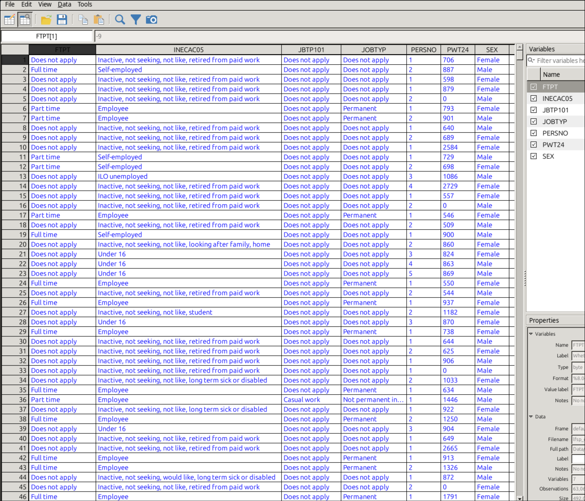

# Estimates of temporary employment

In this exercise, we will recreate an ONS labour market estimate published online in the table [EMP07 Temporary Employees](https://www.ons.gov.uk/employmentandlabourmarket/peopleinwork/employmentandemployeetypes/datasets/temporaryemployeesemp07). Currently, this table is updated four times a year in February, May, August and November using the Quarterly Labour Force Survey (QLFS).

Learning outcomes:

-   To become more familiar with QLFS datasets.
-   To become familiar with producing weighted population estimates
-   To understand how some ONS estimates are produced

## Data

The data used in this exercise relates to an estimate published by the ONS for October-December 2024.

To follow the exercise, you need to access the relevant dataset from the UK Data Service: [Quarterly Labour Force Survey, October - December, 2024](http://doi.org/10.5255/UKDA-SN-9349-3).

## Get set-up

One you have downloaded the data, save it somewhere accessible, for example in a folder named `LFS_exercises`. We can now begin analysing the data using R. First let's load the packages that are are going to need...

...  And open the QLFS dataset:

```{stata open}
cd "~"  
*cd  "~/LFS_exercises"o


* Import  the data from a Stata format dataset 
clear
use  "Data/UKDA-9349-stata/stata/stata13/lfsp_od24_eul_pwt24.dta"

```

Inspect the dataset and find out the number of cases and variables.

```{stata dim}
describe,short
```


::: panel-tabset
## Revision question

How many variables are there?

## Answers

There are 803 variables in the dataset.

:::

As there are many variables in the dataset, let's just keep the variables we are going to use. 


```{stata mydata}
keep PERSNO PWT24 JBTP101 FTPT INECAC05 JOBTYP SEX

desc
```

## Examine the variables

We can have a look at the raw data by using `browse`



Now let's examine in more detail the variables we are going to work with.

```{stata summ}
summ JBTP101 FTPT INECAC05 JOBTYP  SEX

```


This is not very meaningful. Let's use frequency  tables instead:

```{stata tabs1}
ta FTPT
```

```{stata tabs2}
ta JBTP101  
```

```{stata tabs3}
ta INECAC05 
```

```{stata tabs4}
ta JOBTYP
```

```{stata tabs5}
ta SEX
```


::: panel-tabset
## Questions

1.  How many cases are there?

2.  What does the variable `INECAC05` relate to?

3.  Why are there many missing cases on the variables: `JBTP101`, `FTPT` and `JOBTYP`. 

## Answers

1.  There are 63,059 cases

2.  `INECAC05` records  self-reported basic economic activity (ILO definition)

3.  Respondents not in employment are coded as missing values for these variables. Missing values were recorded as -9 "Does not apply" and -8 "No answer" in the original data.
:::


## Weighted and unweighted frequencies

In order to provide reliable estimates of population values, survey data needs to be *weighted* when analysed. Weights are variables whose values increase or decrease the relative importance of observations, depending on how likely respondents were to take part to the survey. Some weights are only designed to correct the relative importance of observations, whereas others in addition also enable calculating population totals - the latter are called grossing weights.

Below, we compare weighted and unweighted frequencies and percentages.

We will be using Stata's specially designed survey commands.

Let us first examine again the variable measuring - JOBTYP - whether respondents work in a temporary job or not:

```{stata freqs}
tab JOBTYP
tab JOBTYP,nol

```

... and create a version without missing values.

```{stata jobtmp}
 
gen JobTmp = 0
replace JobTmp = 1 if JOBTYP==2
replace JobTmp = . if JOBTYP == -8  | JOBTYP == -9  

lab var JobTmp "Whether main  job is temporary"
lab def JobTmp 0 "Not temporary" 1 "Temporary"

lab val JobTmp JobTmp

tab JobTmp JOBTYP, missing

```

We then tell Stata about the weights in the data:

```{stata svydes}
svyset [pw=PWT24]
```

Please note that we needed to remove observations with missing weights values, in effect observations that should not be taken into account to calculate population values. If we don't we will get an error message.

We can now compute weighted frequencies and percentages using a survey specific command: `svy:tab`:

```{stata svyfreqs}
svy:tab JobTmp

svy:tab  JOBTYP,count format(%9.0f)
```

### Review questions

::: panel-tabset
## Questions

1.  Do the frequencies change noticeably when the weight is applied?

2.  Create a variable to indicate those working part time and examine weighted and unweighted frequencies.

## Answers

1.  `PWT24` is a grossing weight. Therefore, frequencies now reflect population totals.

2.  The syntax below computes a variable recording whether respondents work part-time or not and produce weighted frequency tables.

```{stata pt}
ta FTPT, nol

recode FTPT 1 3 =0 2 4 = 1 -8 -9 = ., gen(PartTime) 


lab var PartTime "Whether main  job is part-time"
lab def PartTime 0 "Not part-time" 1 "Part-time"
lab val PartTime PartTime

### Checking the result
tab  FTPT PartTime, missing

### Computing the weighted totals
svy:tab  PartTime,count format(%9.0f)
```


:::

## Splitting by sex and working time status

We then obtain the percentages of full-time and part-time employees by job tenure, by creating a contingency table:

```{stata tmp_ftpt}

svy:tab  PartTime JobTmp,count format(%9.0f)
```

We can add a third variable using the `subpop`option in order to simultaneously examine the number of temporary and part-time employees by gender. We however need to recode SEX as a 0/1 ie dummy variable.

```{stata sex}
*** Creating the dummy variables

tab SEX, gen(sex)

ta sex2

svy,subpop(sex1):tab  PartTime JobTmp,count format(%9.0f)

svy,subpop(sex2):tab  PartTime JobTmp,count format(%9.0f)
```

### Review questions

::: panel-tabset
## Questions

1.  How many people are temporary employees (all and part-time) in this quarter?

2.  How many females are in part-time temporary employment?

3.  How many applicable cases to we have for the above analysis?

## Answers

1.  There are  1,513,083  temporary employees, of which 812,464 part-time.

2.  There are 475,513 females in part-time temporary employment

3.  In order to get the number of valid cases, we need to look at unweighted frequencies. The number of (unweighted) valid cases for this analysis is only 443 respondents.

```{stata unweight} 
bysort SEX: ta JobTmp PartTime
```
:::

Note: You can check if your results match those in the [ONS EMP07 dataset](https://www.ons.gov.uk/employmentandlabourmarket/peopleinwork/employmentandemployeetypes/datasets/temporaryemployeesemp07).
