# Estimates of temporary employment

In this exercise, we will recreate an ONS labour market estimate published online in the table [EMP07 Temporary Employees](https://www.ons.gov.uk/employmentandlabourmarket/peopleinwork/employmentandemployeetypes/datasets/temporaryemployeesemp07). Currently, this table is updated four times a year in February, May, August and November using the Quarterly Labour Force Survey (QLFS).

Learning outcomes:

-   To become more familiar with QLFS datasets.
-   To become familiar with producing weighted population estimates
-   To understand how some ONS estimates are produced

## Data

The data used in this exercise relates to an estimate published by the ONS for October-December 2024.

To follow the exercise, you need to access the relevant dataset from the UK Data Service: [Quarterly Labour Force Survey, October - December, 2024](http://doi.org/10.5255/UKDA-SN-9349-3).

## Get set-up

We suggest that you create a folder named `LFS_exercises` as the working directory for this exercise -- where syntax files and other materials will be stored. After downloading the data, save it in an easily accessible location within `LFS_exercises`, such as a subfolder named `Data`. 
It is recommended to download the data in SPSS format, for better handling of missing values.

We can now open the QLFS dataset from the *File* menu:


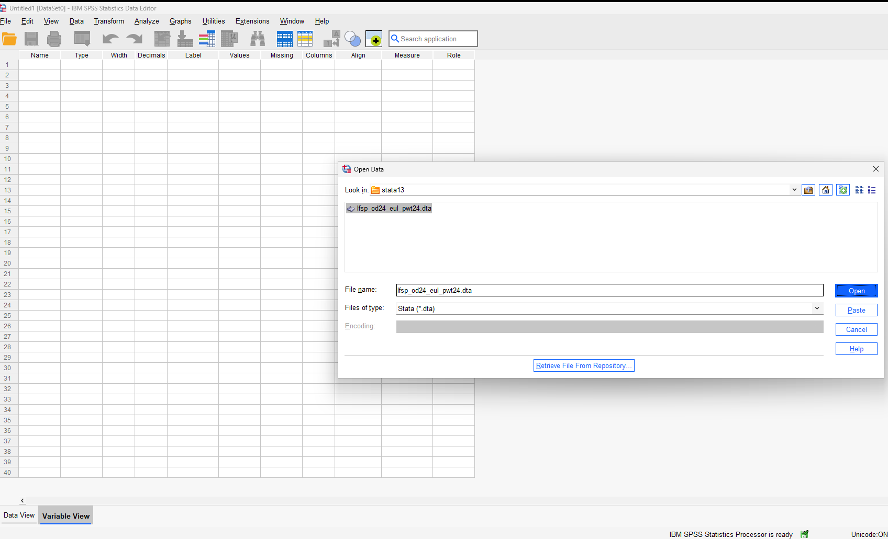{fig-alt="Screenshot of the SPSS File-Open menu"}


Inspect  the dataset and find out the number of cases and variables by scrolling down the list of cases and variables, respectively in *Data* and *Variables* view.


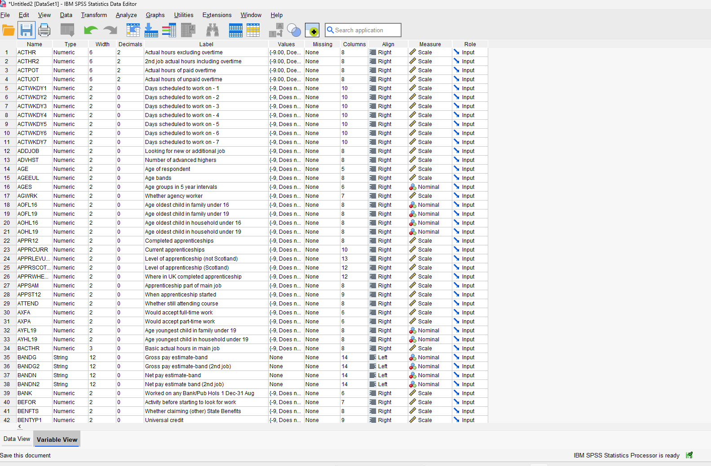{fig-alt="Screenshot of the LFS dataset in the SPSS Variable view tab"}

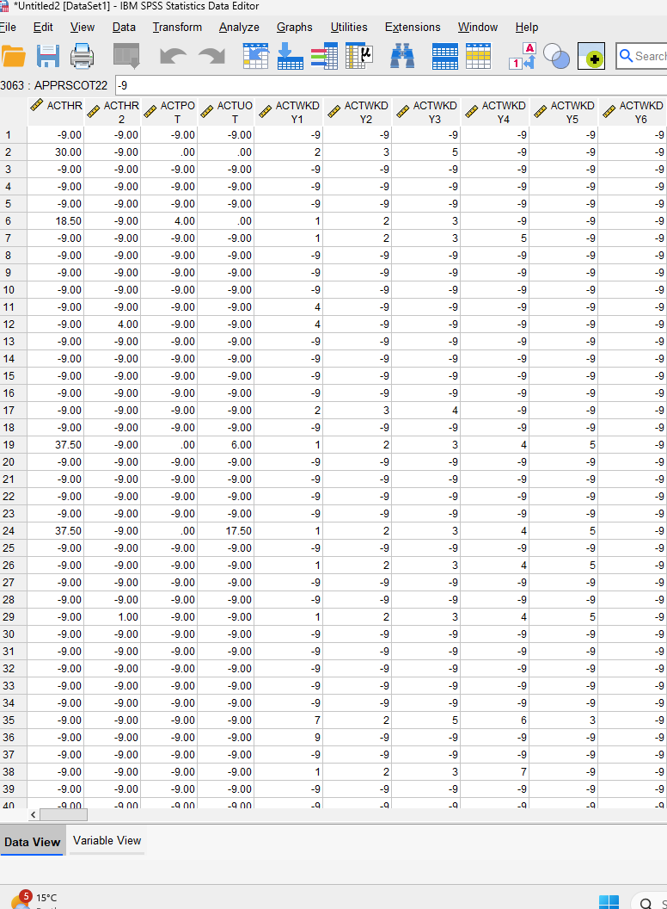{fig-alt="Screenshot of the LFS dataset in the SPSS Data view tab"}


::: panel-tabset
## Revision question

How many variables are there?

## Answers

There are 803 variables in the dataset.

:::

*From now on, we will be using syntax rather than the pull-down menus.*

As there are many variables in the dataset, let's just keep those we are going to use in this exercise. 


```{ mydata}
SAVE OUTFILE='dataex1.sav'
  /KEEP= PERSNO PWT24 JBTP101 FTPT INECAC05 JOBTYP SEX.

GET FILE='dataex1.sav'
```

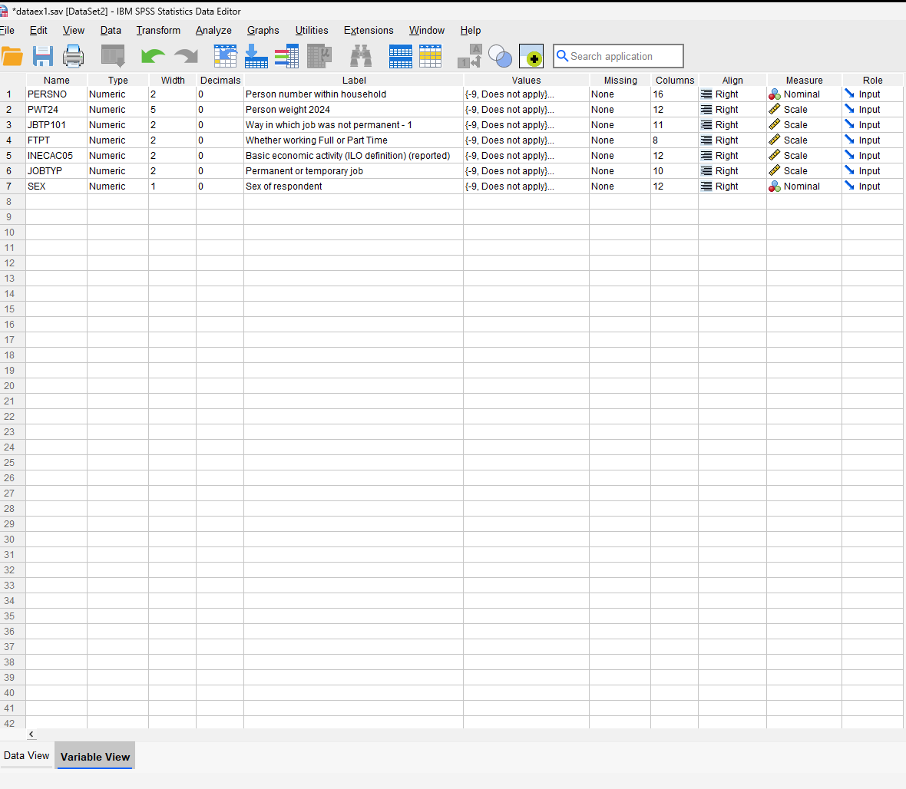{fig-alt="Screenshot of the dataex1 dataset in the SPSS Variable view tab" width=100% height=100%}


## Examine the variables

We already looked at the raw data in the Data View tab. 
Since we know we are dealing with categorical variables, we can just examine their frequency distribution.


```{ summ}
FREQUENCIES VARIABLES=JBTP101 FTPT INECAC05 JOBTYP SEX
  /FORMAT=DFREQ
  /ORDER=ANALYSIS.
```

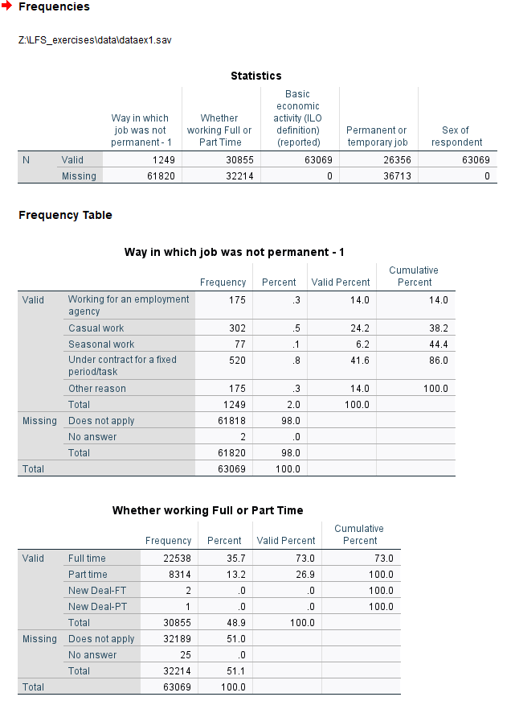{fig-alt="Screenshot of the frequency table for the JBTP101 and FTPT variables in SPSS" width=90% height=90%}}
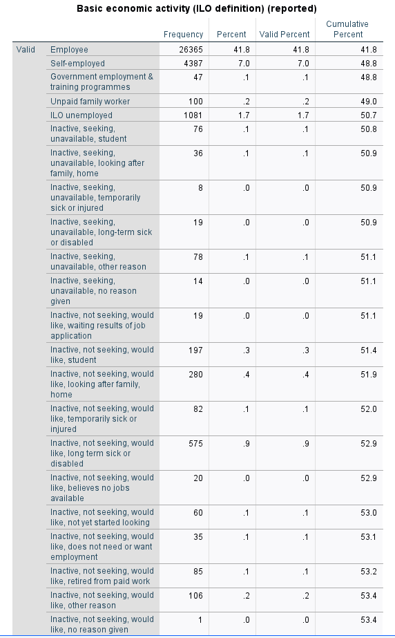{fig-alt="Screenshot of the frequency table for the INECAC05 variables in SPSS" width=90% height=90%}
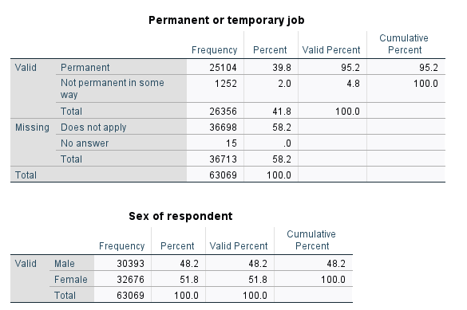{fig-alt="Screenshot of the frequency table for the JOBTYP variables in SPSS" width=90% height=90%}


::: panel-tabset
## Questions

1.  How many cases are there?

2.  What does the variable `INECAC05` relate to?

3.  Why are there many missing cases on the variables: `JBTP101`, `FTPT` and `JOBTYP`? 

## Answers

1.  There are 63,069 cases

2.  `INECAC05` records  self-reported basic economic activity (ILO definition)

3.  Respondents not in employment are coded as missing values for these variables. Missing values were recorded as -9 "Does not apply" and -8 "No answer" in the original data.
:::


## Weighted and unweighted frequencies

In order to provide reliable estimates of population values, survey data needs to be *weighted* when analysed. Weights are variables whose values increase or decrease the relative importance of observations, depending on how likely respondents were to take part to the survey. Some weights are only designed to correct the relative importance of observations, whereas others in addition also enable calculating population totals - the latter are called grossing weights.

Below, we compare weighted and unweighted frequencies and percentages.

Let us first examine again the variable measuring whether respondents work in a temporary job or not - `JOBTYP`. 
In order to avoid issues further down the line, we are going to create a new variable where missing values (ie -9 -8) are coded as system missing. We will call it `JobTmp`.

```{ freqs}
IF (JOBTYP = 1) JobTmp = 0 .
IF (JOBTYP = 2) JobTmp = 1.

* Set to system missing if JOBTYP is -8 or -9.
RECODE JOBTYP (-8=SYSMIS) (-9=SYSMIS).
EXECUTE.
* Create the variable label

VARIABLE LABELS JobTmp "Whether main job is temporary".

 ... And the value labels

VALUE LABELS JobTmp
    0 "Not temporary"
    1 "Temporary".

* Crosstabulation with missing values shown.
CROSSTABS
    /TABLES=JobTmp BY JOBTYP
    /MISSING=INCLUDE.


FREQUENCIES VARIABLES=JobTmp
  /FORMAT=DFREQ
  /ORDER=ANALYSIS.

```

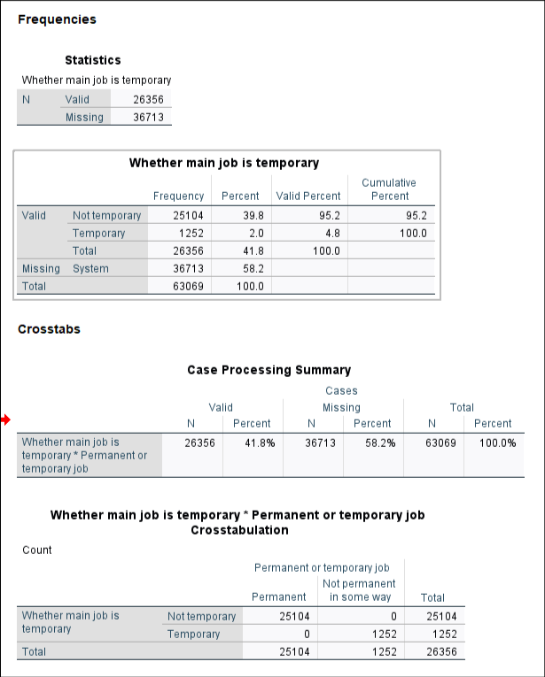{fig-alt="Screenshot of the frequency table of JOBTYP  in SPSS" width=90% height=90%}


<!-- ... and create a version with the missing values recoded as system missing. -->

<!-- ```{ jobtmp} -->

<!-- COMPUTE JobTmp = 0. -->
<!-- IF (JOBTYP = 2) JobTmp = 1. -->

<!-- * Set to system missing if JOBTYP is -8 or -9. -->
<!-- IF (JOBTYP = -8 OR JOBTYP = -9) JobTmp = $SYSMIS. -->

<!-- * Create the variable label -->
<!-- VARIABLE LABELS JobTmp "Whether main job is temporary". -->

<!-- * ... And the value labels -->
<!-- VALUE LABELS JobTmp -->
<!-- 0 "Not temporary" -->
<!-- 1 "Temporary". -->

<!-- * Crosstab with missing values showing missing values -->
<!-- CROSSTABS -->
<!-- /TABLES=JobTmp BY JOBTYP -->
<!-- /MISSING=INCLUDE. -->
<!-- ``` -->

<!-- 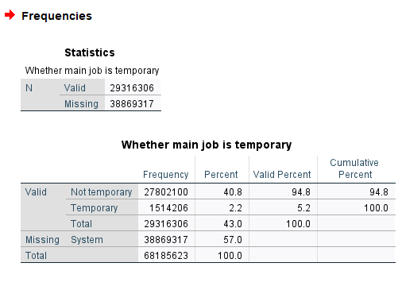{fig-alt="Screenshot of the contingency table of JobTmp by JOBTYP  in SPSS" width=90% height=90%} -->

We then declare  the data to be weighted survey  data:

<!-- ```{svydes} -->
<!-- COMPUTE strat = 0. -->
<!-- COMPUTE clust= 0. -->
<!-- EXECUTE. -->

<!-- CSPLAN ANALYSIS -->
<!--     /PLAN FILE='Z://LFS_exercises/ex1.csaplan' -->
<!--     /PLANVARS ANALYSISWEIGHT=PWT24 -->
<!--     /DESIGN STRATA=start CLUSTER=clust -->
<!--     /ESTIMATOR TYPE=WR. -->
<!-- ``` -->

```{weight}
* Removing missing data on the weights variable
* In order to avoid error messages

SELECT IF (NOT MISSING(PWT24) & PWT24>0).

* Applying  weights

WEIGHT BY PWT24.
```


... And compute the weighted totals and percentages:

```{ svyfreqs}
FREQUENCIES
  /VARIABLES=JOBTYP
  /ORDER=ANALYSIS
  /FORMAT=DFREQ.
  
WEIGHT OFF.  
```

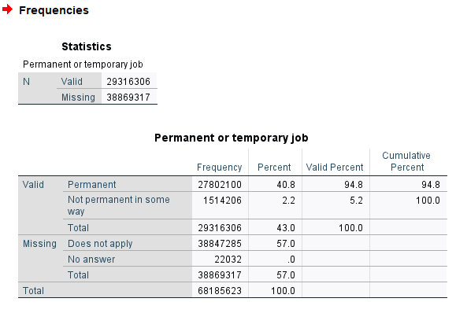{fig-alt="Screenshot of the weighted frequency table of JOBTYP  in SPSS" width=80% height=80%}


### Review questions

::: panel-tabset
## Questions

1.  Do the frequencies change noticeably when the weight is applied?

2.  Create a variable to indicate those working part time and examine weighted and unweighted frequencies.

## Answers

1.  `PWT24` is a grossing weight. Therefore, frequencies now reflect population totals.

2.  The syntax below computes a variable recording whether respondents work part-time or not and produce weighted frequency tables.

```{ pt}
FREQUENCIES VARIABLES=FTPT /ORDER=ANALYSIS.

* Recode FTPT into new variable PartTime.
RECODE FTPT (1 3=0) (2 4=1) (-8 -9=SYSMIS) INTO PartTime.
VARIABLE LABELS PartTime "Whether main job is part-time".
VALUE LABELS PartTime 0 "Not part-time" 1 "Part-time".
EXECUTE.

* Label variable and values.

FREQUENCIES VARIABLES=PartTime
    /FORMAT=DFREQ
    /ORDER=ANALYSIS.

WEIGHT BY PWT24.

FREQUENCIES VARIABLES=PartTime
    /FORMAT=DFREQ
    /ORDER=ANALYSIS.

WEIGHT OFF.
```
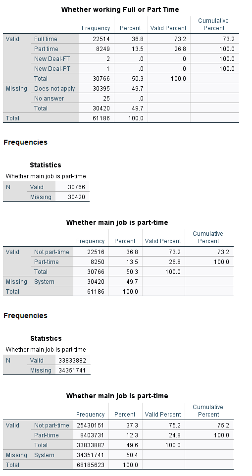{fig-alt="Screenshot of the unweighted and weighted frequency tables  of FTPT  in SPSS" width=90% height=90%}

<!-- 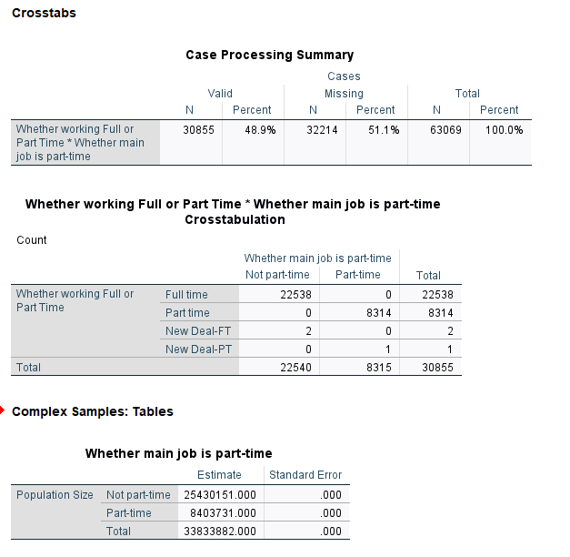{fig-alt="Screenshot of the frequency table  of recoded and weighted version of FTPT - PartTime  in SPSS" width=90% height=90%} -->


:::

## Splitting by sex and working time status

We can obtain the percentages of full-time and part-time employees by job tenure, by creating a contingency table:

```{ tmp_ftpt}
WEIGHT BY PWT24.

* Crosstab to check result.
CROSSTABS 
    /TABLES=PartTime BY JobTmp
    /MISSING=INCLUDE.

WEIGHT OFF.

```

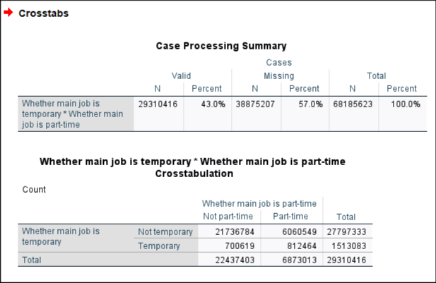{fig-alt="Screenshot of the weighted contingency table  of PartTime by JobTmp  in SPSS" width=90% height=90%}

We can simultaneously examine the number of temporary and part-time employees by gender: 

```{ sex}
* Split the dataset by SEX.
SORT CASES BY SEX.
SPLIT FILE LAYERED BY SEX.

WEIGHT BY PWT24.
* Crosstab of JobTmp by PartTime within each SEX group.
CROSSTABS
  /TABLES=JobTmp BY PartTime
  /MISSING=INCLUDE.

* Turn off split file to resume normal processing.
SPLIT FILE OFF.
WEIGHT OFF.
```

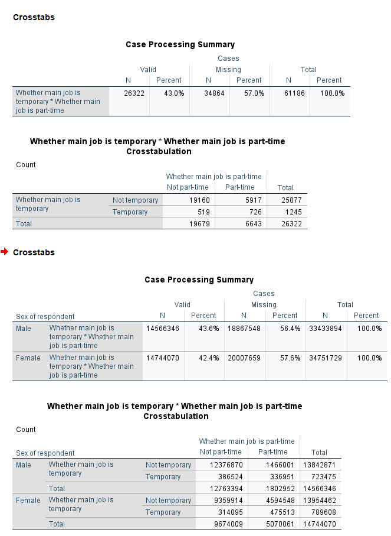{fig-alt="Screenshot of the weighted contingency table  of PartTime by JobTmp  for men and women in SPSS" width=90% height=90%}


### Review questions

::: panel-tabset
## Questions

1.  How many people are temporary employees (all and part-time) in this quarter?

2.  How many females are in part-time temporary employment?

3.  How many applicable cases to we have for the above analysis?

## Answers

1.  There are  1,513,083  temporary employees, of which 812,464 part-time.

2.  There are 475,513 females in part-time temporary employment

3.  In order to get the number of valid cases, we need to look at unweighted frequencies. The number of (unweighted) valid cases for this analysis is only 443 respondents.

```{ unweight} 
* Split the dataset by SEX.
SORT CASES BY SEX.
SPLIT FILE LAYERED BY SEX.

* Crosstab of JobTmp by PartTime within each SEX group.
CROSSTABS
  /TABLES=JobTmp BY PartTime
  /MISSING=INCLUDE.

* Turn off split file 
SPLIT FILE OFF.
```

{fig-alt="Screenshot of the unweighted contingency table  of PartTime by JobTmp  in SPSS" width=90% height=90%}


:::

Note: You can check if your results match those in the [ONS EMP07 dataset](https://www.ons.gov.uk/employmentandlabourmarket/peopleinwork/employmentandemployeetypes/datasets/temporaryemployeesemp07).
