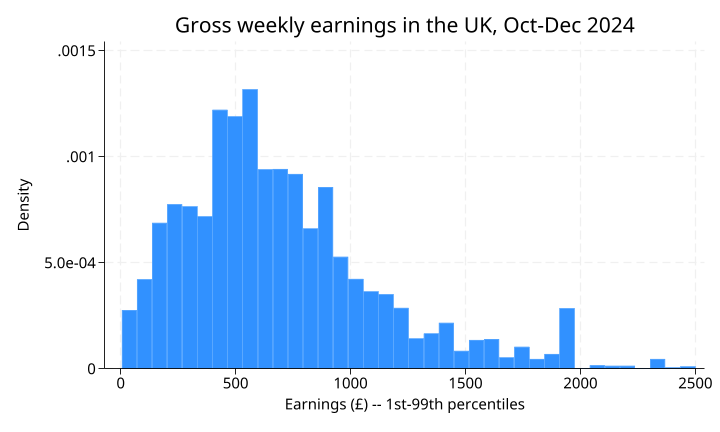
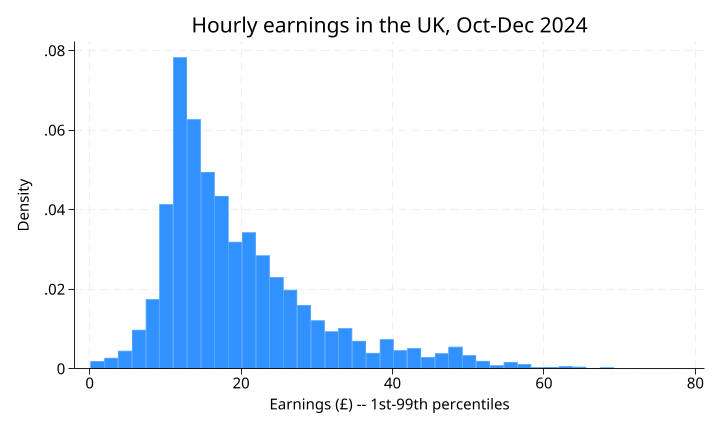

# Weekly earnings of employees

In this exercise, you will recreate a labour market analysis by the ONS, reported in the table [EARN04: Gross weekly earnings of full-time employees \[last accessed 21/02/2025\]](https://www.ons.gov.uk/employmentandlabourmarket/peopleinwork/earningsandworkinghours/datasets/grossweeklyearningsoffulltimeemployeesearn04). Currently, this table is updated four times a year in February, May, August and November using data from the Quarterly Labour Force Survey.

Learning outcomes:

-   To understand better how ONS earnings statistics are produced
-   To become more familiar with key variables from the QLFS
-   To learn  using  income weights appropriately

## Data

The data used in this exercise relates to an estimate published by the ONS for October-December 2024.

To follow the exercise, you need to access the relevant dataset from the UK Data Service: [Quarterly Labour Force Survey, October - December, 2024](http://doi.org/10.5255/UKDA-SN-9349-3).

## Get set up

We will assume that the working directory for this exercise - where syntax files and other materials  will be located - will be a folder named `LFS_exercises`.   Once you have downloaded the data, save it somewhere accessible inside `LFS_exercises`, for example in  another folder named `Data`. 

## Data

The data used in this exercise relates to an estimate published by the ONS for October-December 2024.

To follow the exercise, you need to access the relevant dataset from the UK Data Service: [Quarterly Labour Force Survey, October - December, 2024](http://doi.org/10.5255/UKDA-SN-9349-3).

## Get set-up

One you have downloaded the data, save it somewhere accessible, for example in a `Data` folder inside  `LFS_exercises`. We can now begin analysing the data using R. First let's load the packages that are are going to need...

...  And open the QLFS dataset:

```{stata open}
cd  "LFS_exercises/"

* Import  the data from a Stata format dataset 
use  "Data/UKDA-9349-stata/stata/stata13/lfsp_od24_eul_pwt24.dta"


```

As previously, let's just keep the variables we need for the exercise. 

```{stata mydata}
keep PERSNO PIWT24 PWT24 GRSSWK  INECAC05  ILODEFR FTPT  HOURPAY SEX

```


## Let's examine the dataset

We can use again `describe` in order to inspect the data and the new variables:

```{stata inspect}
describe

```

## Examine weekly earnings

We can also examine descriptive statistics for weekly earnings

```{stata desc1}
summ GRSSWK,detail
```
Non responses are coded using negative values, which may potentially impact on the outcome of statistical analysis. Let's retain  respondents who provided a valid answer only: 

```{stata desc2}
summ GRSSWK if GRSSWK>0,detail
```

We could also have a look at weekly earnings using a histogram. Given that income data tends to be skewed to the right (a relatively small number of respondents have very large earnings), which may affect the legibility of histograms, we will restrict the plot to the earnings of 99% of respondents, leaving out the 1% highest earners.  

The above results tell us that   99% of earners earn less than £2,500 per week . 


```{stata plot}
quietly histogram   GRSSWK if GRSSWK>0 & GRSSWK<=2500,  xtitle("Earnings (£) -- 1st-99th percentiles") title("Gross weekly earnings in the UK, Oct-Dec 2024")
```

```{stata plot}
*| echo: FALSE
quietly graph export "~/OneDrive/trainings/LFS_module/LFS_exercises/pics/grsw.png", replace
```



::: panel-tabset


## Question

Plot the distribution of hourly earnings  up to the 99th percentile.

## Answer
```{stata hourly}
summ HOURPAY if HOURPAY>0,detail

quietly histogram  HOURPAY if HOURPAY>0 & HOURPAY<=69.23, xtitle("Earnings (£) -- 1st-99th percentiles") title("Hourly earnings in the UK, Oct-Dec 2024")
```

```{stata printh}
*| echo: FALSE

quietly graph export "~/OneDrive/trainings/LFS_module/LFS_exercises/pics/hpay.png", replace

```



:::


## Examine full-time employees

It is important to remain mindful of definitions:

- *Employees* refers to people who whose jobs implies working under an employment contract for an employer; 
- *Employed* refers to people who are  both employees and self employed ie who have a paid job.

- *Full-time* and *part-time* refer to people's self declared working-time status, irrespective of whether they are employed or self-employed

LFS  data provides the INECAC05 variable, which records all nuances of economic activity (there are 35 of them!), including employment and self-employment. There is also ILODEFR which records the broad economic activity status (ie Whether employed, unemployed, etc.) and group together self-employed and employees.

We will now examine these  variables.

```{stata summ2}         
summ INECAC05
tab INECAC05

summ FTPT
tab FTPT
```

If we further want to know about about the number of employees by working-time status, we will need to explictly restrict the analysis to those: 

```{stata tabdesc}         
tab FTPT if INECAC05==1
```

There are 19,680 full-time employees in the  sample.

::: panel-tabset
## Question

1. Provide a similar  description for the summarised economic activity variable.
2. How many  *self-employed* respondents working full-time are there in the sample?

## Answer
1. 
```{stata  subset}
summ ILODEFR
tab ILODEFR
```

2. 
```{stata ex2.2}         
tab FTPT if INECAC05==2
```


There are 2,823 respondents in full-time self-employment in the sample.
:::


## ONS estimates for employees' gross weekly earnings

The code below recreates the ONS results showing the distribution of income for full-time employees overall and by gender. 
It does it in three stages:

- First, we create a variable to flag to match the ONS' definition of full-time employees  (ie those who work full-time and earn up to £100 hourly). 

   It may be a good idea to double check the definition used by the ONS [in its publication.](https://www.ons.gov.uk/employmentandlabourmarket/peopleinwork/earningsandworkinghours/datasets/grossweeklyearningsoffulltimeemployeesearn04) Looking at the notes under the Table EARN04, we learn that ONS figures are only computed for  respondents' main job, and also that *those earnings more than £100 per hour* are excluded. 


```{stata ftEmp}
gen ftEmp=0
replace ftEmp=1 if FTPT==1 & HOURPAY<=100 & INECAC05==1 

lab var ftEmp "Whether a full-time employee  - ONS definition"
lab def ftEmp 0 "Anything else" 1 "Full-time employee"
lab val  ftEmp ftEmp

tab ftEmp
```

Stata does not directly allow computing median  with survey data due to issue with variance estimation. We follow the solution suggested here: [] 

```{stata svy}
_pctile GRSSWK  if ftEmp==1 [pw=PIWT24]

return list
```


The median weekly earnings of  full-time employees in the UK in October-December 2024 was £692. We need to keep in mind that by using the income weights `PIWT`, those with missing values on `GRSSWK` are automatically left out. If for some reason  we are not using these, we will have to exclude missing values  explicitly (`GRSSWK>0`)

::: panel-tabset
## Questions

1.  What are the median weekly earnings for men and women in the UK?

2.  What are earnings at the lowest decile for males and females  in the UK?

3. Why are we using a different weight from exercise 1?


## Answers

1.  

```{stata answer1}
_pctile GRSSWK  if ftEmp==1 & SEX==2 [pw=PIWT24]
return list

_pctile GRSSWK  if ftEmp==1 & SEX==1  [pw=PIWT24]
return list
```
Median weekly earnings of women and men in the UK are respectively £650 and £731

2.  

```{stata  answer2}
_pctile GRSSWK  if ftEmp==1 & SEX==2 [pw=PIWT24],p(10)
return list

_pctile GRSSWK  if ftEmp==1 & SEX==1  [pw=PIWT24],p(10)
return list
```
The median weekly earnings for men and women in the lowest decile in the UK are  respectively £412 and £434


3. Because earnings are computed for a specific subpopulation: those in employment with valid earnings data.

:::

## How many people work as full-time employee?
This question relies on  a slightly different definition that we have used so far since this time we won't excludce those earning more than £100 per hour. This means we need to recreate a new variable to flag this group, or pass directly the definition to the estimation function. The figures published by the ONS can be found [in Table EMP01 here](https://www.ons.gov.uk/employmentandlabourmarket/peopleinwork/employmentandemployeetypes/datasets/fulltimeparttimeandtemporaryworkersnotseasonallyadjustedemp01nsa).

Let's follow the same steps as before: 

1. Let's flag full-time employees (no limit on hourly pay this time):

```{stata ftEmp2}
gen ftEmp2=0
replace ftEmp2=1 if FTPT==1 &  INECAC05==1 

lab var ftEmp2 "Whether a full-time employee  - unrestricted"
lab val  ftEmp ftEmp2

tab ftEmp2
```

Let's tell Stata that we are working with survey data. 

```{stata svy}

svyset [pw=PIWT24]
```

And finally, let's produce our estimates: 

```{stata ftest}
svy,subpop(ftEmp2):total FTPT, cformat(%9.0f)
```


::: panel-tabset
## Question

1. The ONS table gives the estimated number of full-time employees as 22,430,659. Above, we get 22,442,379. Why is there a difference?

2. What steps need to be different to get the correct estimate of the number of full-time employees?

3. What is the correct estimated number of: 

    - full-time employees; 
    - female and male full-time employees in the UK?

## Answer
1. Because we have used the wrong weights ie PIWT24, the weights that can only be used for earnings estimation

2. We need to rerun the `svy` commands using  the correct weighting variable: PWT24

```{stata sa}
svyset [pw=PWT24]
svy,subpop(ftEmp2):total FTPT, cformat(%9.0f)
```
3. 

```{stata corr2}
* Grouping employee flag and gender
egen ftEmpS=group(SEX ftEmp2),label 
tab ftEmpS,gen(FtES)  

*** Full-time employees, males
svy,subpop(FtES2):total FTPT, cformat(%9.0f) 

***  Full-time employees, females
svy,subpop(FtES4):total FTPT, cformat(%9.0f) 
```

In October - December 2024, there were respectively 9,670,422 female and 12,760,237  male full-time employees.

:::


## What next?

- See if you can examine earnings for temporary workers or another group of interest. Examine the full dataset and explore as you choose.

- Move to the next exercise, which uses one of the LFS longitudinal datasets.
