# Using SPSS 

## Weekly earnings of employees {.unnumbered .unlisted}


In this exercise, you will recreate a labour market analysis by the ONS, reported in the table [EARN04: Gross weekly earnings of full-time employees \[last accessed 21/02/2025\]](https://www.ons.gov.uk/employmentandlabourmarket/peopleinwork/earningsandworkinghours/datasets/grossweeklyearningsoffulltimeemployeesearn04). Currently, this table is updated four times a year in February, May, August and November using data from the Quarterly Labour Force Survey.

Learning outcomes:

-   To understand better how ONS earnings statistics are produced
-   To become more familiar with key variables from the QLFS
-   To learn  using  income weights appropriately

## Data

The data used in this exercise relates to an estimate published by the ONS for October-December 2024.

To follow the exercise, you need to access the relevant dataset from the UK Data Service: [Quarterly Labour Force Survey, October - December, 2024](http://doi.org/10.5255/UKDA-SN-9349-3).

## Get set up

We suggest that you create a folder named `LFS_exercises` as the working directory for this exercise -- where syntax files and other materials will be stored. After downloading the data, save it in an easily accessible location within `LFS_exercises`, such as a subfolder named `Data`.


Let's open the QLFS dataset from the *File* menu:

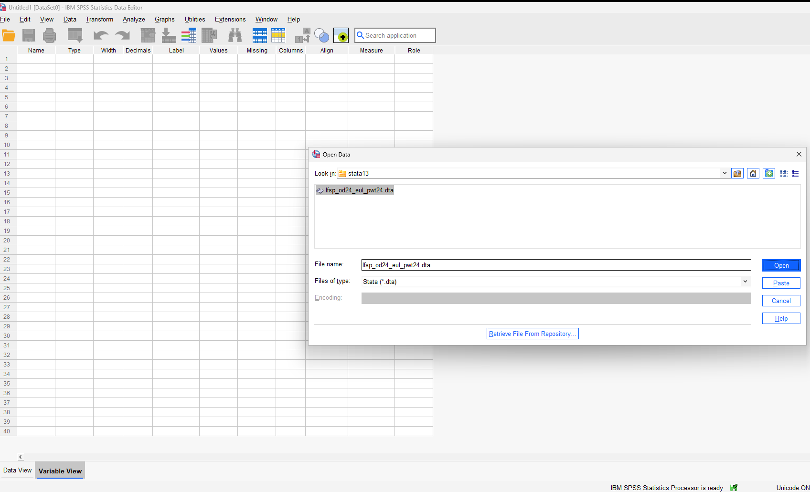{fig-alt="Screenshot of the SPSS File-Open menu"}


As previously, let's just keep the variables we need for the exercise. 

```{ mydata}
  save OUTFILE="Z://LFS_exercises/data/dataex1.sav" 
    /KEEP= PERSNO PIWT24 PWT24 GRSSWK  INECAC05  ILODEFR FTPT  HOURPAY SEX.

get FILE="Z://LFS_exercises/data/dataex1.sav". 
```


## Examine the dataset

Let's inspect the data and the new variables by looking at the variables and data view:

::: {#fig-elephants layout-ncol=2}

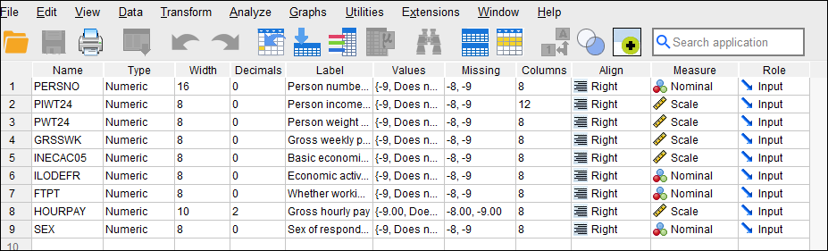{fig-alt="Exercise 2 dataset, variable view"}

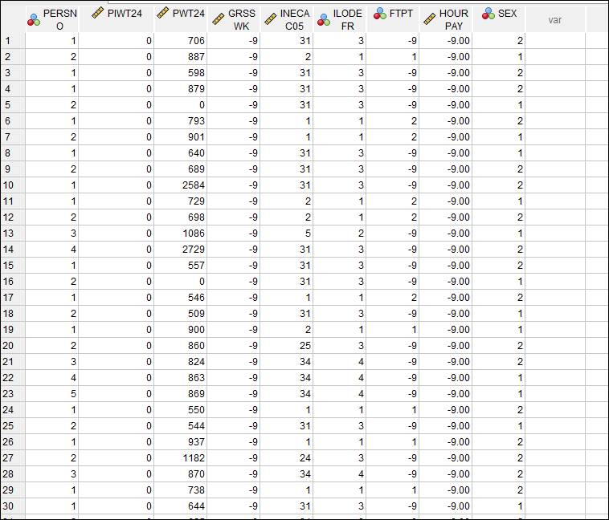{fig-alt="Exercise 2 dataset, data  view"}

Inspecting the data
:::


We can also examine the descriptive statistics of  weekly earnings

```{ desc1}
DESCRIPTIVES VARIABLES=GRSSWK
    /STATISTICS=MEAN STDDEV MIN MAX.
```

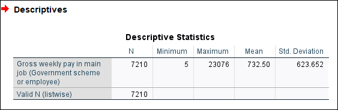{fig-alt="Descriptive statistics of GRSSWK, gross weekly earnings"}

Let's plot the distribution of weekly earnings using a histogram. Given that income data tends to be skewed to the right (a relatively small number of respondents have very large earnings), which reduces the visibility lower earnings, we will leaving out the 1% highest earners, that is respondents  earning more than £2,500 per week. 


```{ plot}
TEMPORARY.
SELECT IF (GRSSWK<=2500).
EXECUTE.

GRAPH
  /HISTOGRAM=GRSSWK.
```

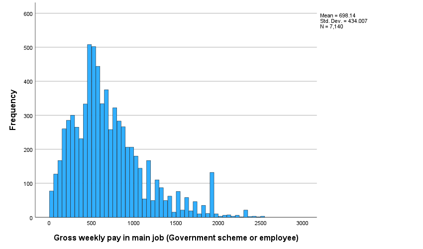{fig-alt="Histogram of Gross Weekly earnings"}


## Examine full-time employees

It is important to remain mindful of definitions:

- *Employees* refers to people who whose jobs implies working under an employment contract for an employer; 
- *Employed* refers to people who are  both employees and self employed ie who have a paid job.

- *Full-time* and *part-time* refer to people's self declared working-time status, irrespective of whether they are employed or self-employed

The INECAC05 variable records all nuances of economic activity (there are 35 of them!), including employment and self-employment. There is also ILODEFR which records broader economic activity status (ie Whether employed, unemployed, or on a government training scheme etc.) and group together self-employed and employees.

We will now examine these  variables.

First, economic activity... 

```{ tab_inecac}         
FREQUENCIES VARIABLES= INECAC05 
  /ORDER=ANALYSIS.
```
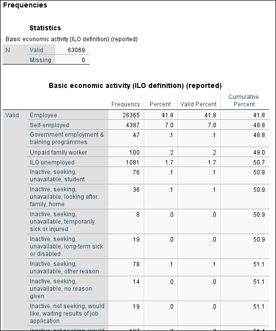{fig-alt="SPSS Frequency table of INECAC05 "}

Then working-time status.


```{ tab_ftpt}  
FREQUENCIES VARIABLES= FTPT
  /ORDER=ANALYSIS.

```
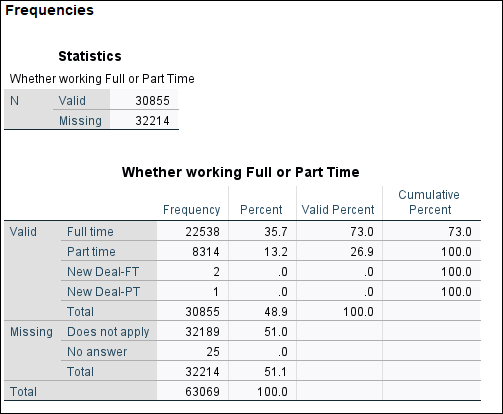{fig-alt="SPSS Frequency table of FTPT "}

If we further want to know about about the number of employees by working-time status, we will need to explicitly restrict the analysis to those: 


```{ tab_employ}  
TEMPORARY.
SELECT IF (INECAC05=1).
EXECUTE.

FREQUENCIES VARIABLES= FTPT
  /ORDER=ANALYSIS.
```
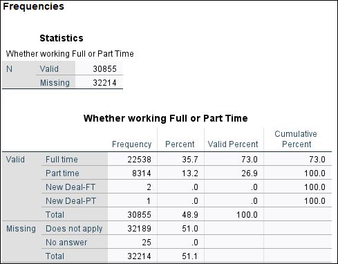{fig-alt="SPSS Frequency table of FTPT for employees only"}

There are 19,680 full-time employees in the  sample.


## ONS estimates for employees' gross weekly earnings

The code below recreates the ONS results showing the distribution of income for full-time employees overall and by gender. We do it in two stages:

- First, we create a variable to match the ONS' definition of full-time employees

   It is always a good idea to double check the ONS definition  [in its publication.](https://www.ons.gov.uk/employmentandlabourmarket/peopleinwork/earningsandworkinghours/datasets/grossweeklyearningsoffulltimeemployeesearn04) Looking at the notes under the Table EARN04, we learn that ONS figures are only computed for  respondents' main job, and also that *those earnings more than £100 per hour* are excluded. 


```{ ftEmp}
* Creating the variable
COMPUTE ftEmp = 0.
IF (FTPT = 1 AND HOURPAY <= 100 AND INECAC05 = 1) ftEmp = 1.

* Defining and assigning  value labels.

VARIABLE LABELS ftEmp "Whether a full-time employee - ONS definition".
VALUE LABELS ftEmp
  0 "Anything else"
  1 "Full-time employee".

* Inspecting the result

FREQUENCIES VARIABLES=ftEmp.
```

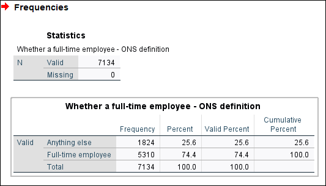{fig-alt="SPSS Frequency table of whether employed full-time (ONS definition)"}

- We then compute the median earnings for full-timers matching the ONS definition:

```{ svy}
* Applying weights
WEIGHT BY PIWT24.

* Selecting the subpopulation of employees
TEMPORARY.
SELECT IF (ftEmp = 1 & NOT MISSING(PIWT24 )).
EXECUTE.

* Getting the median
FREQUENCIES VARIABLES=GRSSWK
  /FORMAT=NOTABLE
  /STATISTICS=MEAN MEDIAN
  /ORDER=ANALYSIS.
  
WEIGHT OFF.
```
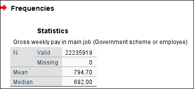{fig-alt="SPSS Estimate  of median gross weekly earnings for the full time employed"}


The median weekly earnings of  full-time employees in the UK in October-December 2024 was £692. We need to keep in mind that by using the income weights `PIWT`, those with missing values on `GRSSWK` are automatically left out.

::: panel-tabset
## Questions

1.  What are the median weekly earnings for men and women in the UK?

2.  What are earnings at the lowest decile for males and females  in the UK?

3. Why are we using a different weight from Exercise 1?


## Answers

1.  

```{ answer1}
WEIGHT BY PIWT24.

TEMPORARY.
SELECT IF (ftEmp = 1 & NOT MISSING(PIWT24 )).
EXECUTE.
* 2. Apply weighting variable.

* 3. Request percentiles for GRSSWK.
FREQUENCIES VARIABLES=GRSSWK
  /FORMAT=NOTABLE
  /STATISTICS=MEAN MEDIAN
  /ORDER=ANALYSIS.
WEIGHT OFF.
```

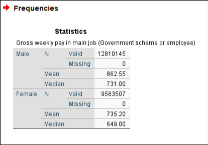{fig-alt="SPSS Output  for median gross weekly earnings for the full time employed men and women"}

Median weekly earnings of women and men in the UK are respectively £650 and £731

2.  

```{  answer2}

WEIGHT BY PIWT24.

SORT CASES BY SEX.
SPLIT FILE BY SEX.

TEMPORARY.
SELECT IF (ftEmp = 1 & PIWT24>0 & NOT MISSING(PIWT24)).

* 10th percentile.
FREQUENCIES VARIABLES=GRSSWK
   /FORMAT=NOTABLE
  /PERCENTILES=10.0 
  /ORDER=ANALYSIS.

SPLIT FILE OFF.
WEIGHT OFF.
```
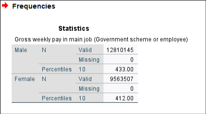{fig-alt="SPSS Output  for median gross weekly earnings for the full time employed men and women"}

The median weekly earnings for men and women in the lowest decile in the UK are  respectively £412 and £433


3. Because earnings are computed for a specific subpopulation: those in employment with valid earnings data.

:::

## How many people work as full-time employee?

This question relies on  a slightly different definition that we have used so far since this time we won't exclude those earning more than £100 per hour. The figures published by the ONS can be found in the same table as previously.

Let's follow the same steps as before: 

1. Let's flag full-time employees (no limit on hourly pay this time):

```{ ftEmp2}
Create the new Full-time flag
COMPUTE ftEmp2 = 0.

IF (FTPT = 1 AND INECAC05 = 1) ftEmp2 = 1.

VARIABLE LABELS ftEmp "Whether a full-time employee - general definition".

VALUE LABELS ftEmp2
  0 "Anything else"
  1 "Full-time employee (all)".

FREQUENCIES VARIABLES=ftEmp2.
```
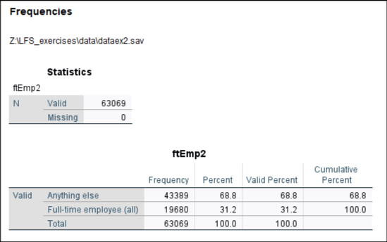{fig-alt="SPSS Frequency table for the general Full-time flag (no hourly earnings restrictions)"}


And finally, let's produce  estimates of their number in the population: 

```{ ftest}
WEIGHT BY PIWT24.

TEMPORARY.
SELECT IF (PIWT24>0 & NOT MISSING(PIWT24)).

FREQUENCIES VARIABLES=ftEmp2
  /ORDER=ANALYSIS.

WEIGHT OFF.
```

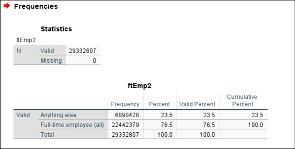{fig-alt="SPSS Frequency table for the general Full-time flag (no hourly earnings restrictions) weighted with PIWT24"}


::: panel-tabset
## Question

1. The ONS table gives the estimated number of full-time employees as 22,430,659. Above, we get 22,442,379. Why is there a difference?

2. What steps need to be different to get the correct estimate of the number of full-time employees?

3. What is the correct estimated number of: 

    - full-time employees; 
    - female and male full-time employees in the UK?

## Answer
1. Because we have used the wrong weights ie PIWT24, the weights that can only be used for earnings estimation

2. We need to rerun the commands using  the correct weighting variable: PWT24

```{ sa}
* Apply weight.
WEIGHT BY PWT24.

TEMPORARY.
SELECT IF (PWT24>0 & NOT MISSING(PWT24)).

FREQUENCIES VARIABLES=ftEmp2
    /ORDER=ANALYSIS.

WEIGHT OFF.
```

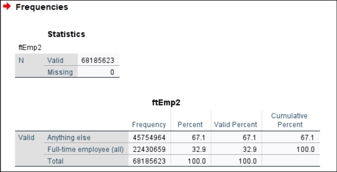{fig-alt="SPSS Frequency table for the general Full-time flag (no hourly earnings restrictions) weighted with PWT24"}


3. 

```{ corr2}
* Apply weight.
WEIGHT BY PWT24.
* Split output by SEX (1=Male, 2=Female).
SORT CASES BY SEX.
SPLIT FILE BY SEX.

TEMPORARY.
SELECT IF (PWT24>0 & NOT MISSING(PWT24)).

* Number of full-time employees by gender
FREQUENCIES VARIABLES=ftEmp2
  /ORDER=ANALYSIS.

* Turn off split and weight afterward.
SPLIT FILE OFF.
WEIGHT OFF.
  
```

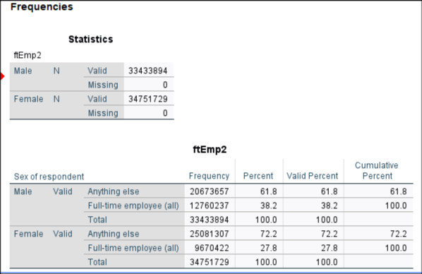{fig-alt="SPSS Frequency table for the general Full-time flag (no hourly earnings restrictions) weighted with PWT24"}

In October - December 2024, there were respectively 9,670,422 female and 12,760,237  male full-time employees.

:::


## What next?

- See if you can examine earnings for temporary workers or another group of interest. Examine the full dataset and explore as you choose.

- Move to the next exercise, which uses one of the LFS longitudinal datasets.
