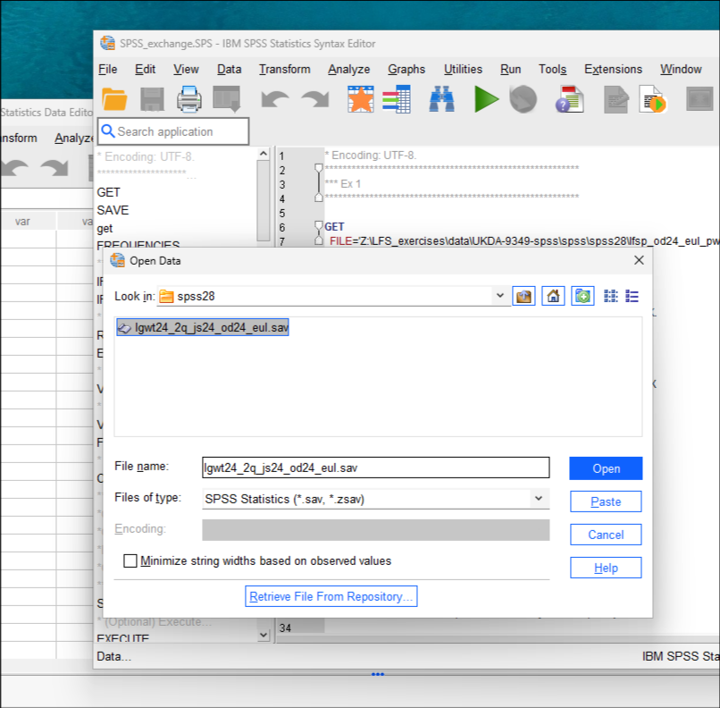
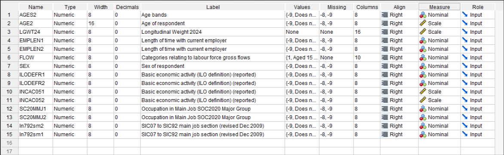
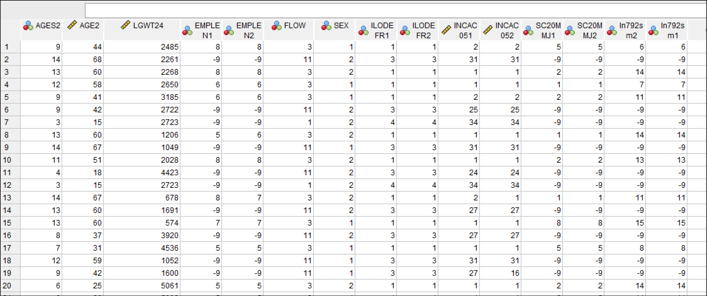
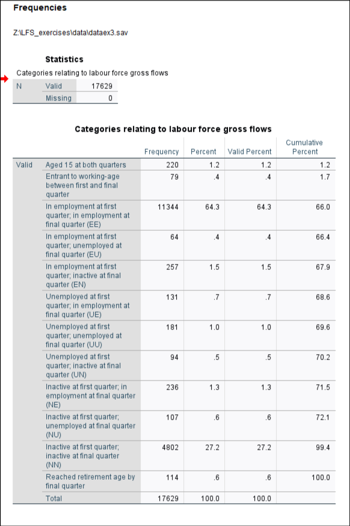
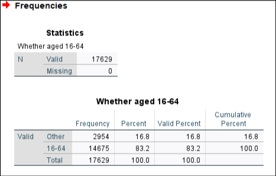
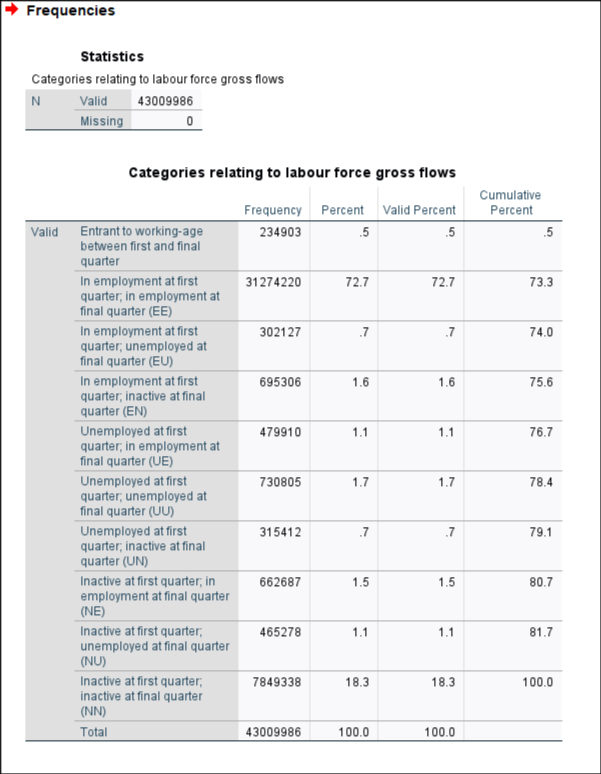
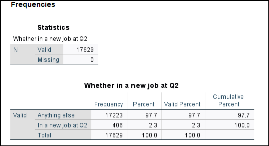
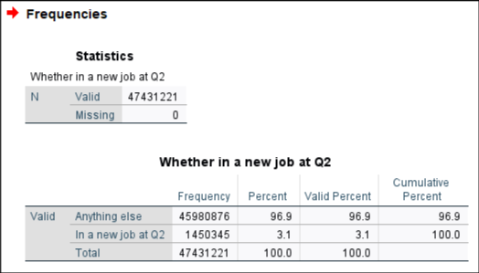
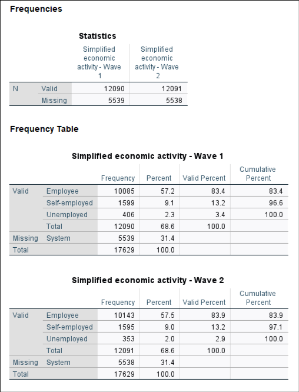
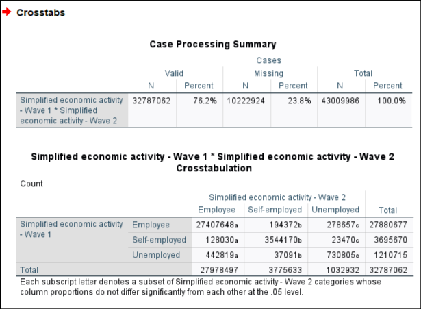

# Using SPSS 

## Labour Market Flows {.unnumbered .unlisted}


The exercise presents three different methods for examining labour market flows - ie the transitions between one kind of involvement in paid work (for example, full-time employed) to another one (for example, economically inactive) using longitudinal data from the Labour Force Survey. 

The estimates in this exercise  relate to figures published by ONS on the 'Labour market flows NSA' sheet in [Table X02.](https://www.ons.gov.uk/employmentandlabourmarket/peopleinwork/employmentandemployeetypes/datasets/labourforcesurveyflowsestimatesx02) NSA stands for 'non seasonally adjusted', as we will be  examining flows that took place between two quarters (as opposed to seasonally adjusted yearly averages).  

Learning outcomes:

- Becoming familiar with Two Quarter Longitudinal Labour Force Survey data
- Being able to estimate labour market flows using different methods
- Being able to use longitudinal weights


## Data

This exercise  relies on  the Two-Quarter LFS Longitudinal Dataset  for July - December 2024, which is available from the UK Data Service [(Study number 9348).](http://doi.org/10.5255/UKDA-SN-9348-1) 

## Get set up

We suggest that you create a folder named `LFS_exercises` as the working directory for this exercise -- where syntax files and other materials will be stored. After downloading the data, save it in an easily accessible location within `LFS_exercises`, such as a subfolder named `Data`.


Let's open the LLFS dataset from the *File* menu:

{fig-alt="Screenshot of the SPSS File-Open menu"}


As previously, let's just keep the variables we need for the exercise. 

```{ mydata}
save OUTFILE="Z://LFS_exercises/data/dataex3.sav"
     /KEEP= AGES2 AGE2 LGWT24 EMPLEN1 EMPLEN2 FLOW SEX ILODEFR1 ILODEFR2 INCAC051 INCAC052 SC20MMJ1 SC20MMJ2 In792sm2 In792sm1.

get FILE="Z://LFS_exercises/data/dataex3.sav". 
```


## Examine the working dataset

Let's inspect the data and the new variables by looking at the variables and data view:


{fig-alt="Exercise 3 dataset, variable view"}

{fig-alt="Exercise 3 dataset, data  view"}


::: panel-tabset
### *Review questions 1*

1. What is the FLOW variable?

2. Why do some variables have a suffix of 1 or 2?

### Answers

1. FLOW measures labour market flows, that is the transitions between economic activity statuses

```{} 
FREQUENCIES VARIABLES=FLOW
  /ORDER=ANALYSIS.
```

{fig-alt="Frequency distribution of the LFS FLOW variable"}


2. The suffix in most  variables indicates the wave ie the quarter at which it was recorded.

:::


## Method 1: Using the FLOW variable 

In order to match the definition used by the ONS for their published  estimates, we will examine the  FLOW variable but only consider respondents aged 16-64. We will then weight the variable with the longitudinal weight `LGWT24`. In addition to  adjusting for non-response and sampling error, longitudinal weights also correct for respondents who drop out from the survey between waves.


As before, we begin by  flagging those aged 16-64:


```{ wrkage}
COMPUTE wrkage = 0.
IF (AGE2 >= 16 AND AGE2 <= 64) wrkage = 1.
EXECUTE.

VARIABLE LABELS wrkage "Whether aged 16-64".
VALUE LABELS wrkage
  0 "Other"
  1 "16-64".

FREQUENCIES VARIABLES=wrkage.
```

{fig-alt="Frequency distribution of the wrkage variable"}


We then   compute  the weighted frequencies: 

```{ total}
WEIGHT BY LGWT24.

TEMPORARY.
SELECT IF (wrkage = 1).

FREQUENCIES VARIABLES=FLOW
  /ORDER=ANALYSIS.

WEIGHT OFF.
```

{fig-alt="Frequency distribution of the weighted FLOW variable"}


::: panel-tabset
### *Review question 2*

How many people were in employment in both the first quarter and  final quarter?

### Answers

The second line of the table above  tells us that there were 31,274,220 people in employment both in June-August and September-December 2024 

::: 

## Method 2: Employment situation at W1 and W2

Here we examine the  situation of respondents at the first and second quarters. Let us first flag those who went into a new job at the second quarter and examine their frequency distribution:


```{ select}


COMPUTE NewJob = 0.

IF (ILODEFR2 = 1  & EMPLEN2 = 1 &  wrkage = 1) NewJob = 1.

EXECUTE.

VARIABLE LABELS NewJob  "Whether in a new job at Q2".

VALUE LABELS NewJob
  0 "Anything else"
  1 "In a new job at Q2".

FREQUENCIES VARIABLES=NewJob.
```

{fig-alt="Frequency table of NewJob"}

Let us now produce the estimate of the number of people in the population who went into a new job at the second quarter:

```{}
* Apply weight.
WEIGHT BY LGWT24.


FREQUENCIES VARIABLES=NewJob
  /ORDER=ANALYSIS.

WEIGHT OFF.


```

{fig-alt="Estimates of the number of people in a new job at Q2"}

::: panel-tabset
### *Review question 3*

What has been estimated with the flag and table above?

*Hint: examine the two variables used in the filter to understand the selection*

### Answer

The table measures the number of people who either changed jobs or moved into employment between the first and second quarter. 

:::


## Method 3: Cross-tabulation  

This time we will be looking at transitions between employment broadly defined  and self-employment from wave 1 to wave 2.  
In order to do this, we will create a simplified economic activity variable recording employees (including those on training schemes as well as unpaid family workers) the unemployed, and the economically  inactive at waves  1 and 2.

```{ econac}
* Wave 1 
RECODE INCAC051 (1,3,4=1) (2=2) (5=3) (6 THRU 34=SYSMIS) INTO eco1.
VARIABLE LABELS eco1 "Simplified economic activity - Wave 1".
VALUE LABELS eco1
  1 "Employee"
  2 "Self-employed"
  3 "Unemployed".

* Wave 2.
RECODE INCAC052 (1,3,4=1) (2=2) (5=3) (6 THRU 34=SYSMIS) INTO eco2.
VARIABLE LABELS eco2 "Simplified economic activity - Wave 2".
VALUE LABELS eco2
  1 "Employee"
  2 "Self-employed"
  3 "Unemployed".
EXECUTE.

FREQUENCIES VARIABLES=eco1 eco2.
```
{fig-alt="Frequency tables of ECO1 and ECO2, simplified economic activity at Wave 1 and Wave 2 "}

We can now examine the transitions between economic activity states at Q1 and Q2:  by creating  a cross-tabulation of economic activity at wave 1 and wave 2. We will rely again on `wrkage` to limit the analysis on the 16-64 as well as on the longitudinal weights.   


```{}
WEIGHT BY LGWT24.

TEMPORARY.
SELECT IF (wrkage = 1).

CROSSTABS
  /TABLES=eco1 BY eco2
  /CELLS=COUNT PROP
  /COUNT ROUND CELL.

WEIGHT OFF.
```
<!-- {fig-alt="Contingency table tables of ECO1 by ECO2"} -->


::: panel-tabset

### *Review questions 4*
What were the flows (ie number of people transitioning) between:

1. Employment and self-employment  
2. Self-employment to employment?

### Answers

1. There were approximatively 194,372 people moving from  employment to self-employment between  July-August  and  September-December 2024.

2.  About 128,030 people who were  self-employed in July-August 2024 had become  employee by September-December 2024. 
  
:::  

## What next? 

This was the final structured exercise. Some ideas for what to do next are:

- Use the methods above to examine flows between industry or occupation (SC10MMJ1 SC10MMJ2 in792sm2 in792sm1).
- Open the full dataset to examine what variables in the Two-Quarter Longitudinal Dataset.


