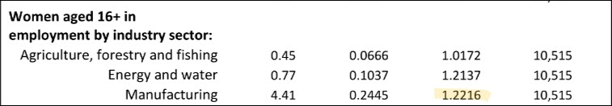
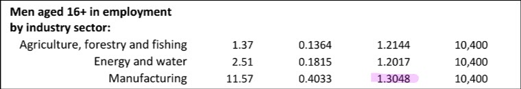

# Exercise 4: <BR/> Estimate precision and uncertainty


This series of exercises focuses on the precision of estimates calculated from  Labour Force Survey data, in other words  the degree to which we can trust  them to reflect  the likely values in  the population. In order to do this, we will compute similar measures as before - means and proportions but this time  we will be focusing on their confidence intervals.

Learning objectives:

- To be able to compute and interpret confidence intervals of earnings in the LFS;
- To be able to assess the impact of weighting on weighting ;
- To be able to interpret CIs for regional differences;
- To be able to use published LFS design effects  and apply them to your own estimates;

## Data

In this exercise we will be using Quarterly LFS data for October-December 2024.

To follow the exercise, you need to access the relevant dataset from the UK Data Service: [Quarterly Labour Force Survey, October - December, 2024](http://doi.org/10.5255/UKDA-SN-9349-3).

## Get set up

We will assume that the working directory for this exercise - where syntax files and other materials  will be located - will be a folder named `LFS_exercises`.   Once you have downloaded the data, save it somewhere accessible inside `LFS_exercises` for example in a folder called `Data.

We can now begin analysing the data using R. First let's load the packages that we are going to need:

```{r}
library(haven)  ### Functions to open Stata or SPSS datasets
library(dplyr)  ### Easier data manipulation
library(survey) ### Survey data analysis functions
library(srvyr)  ### Easier  manipulation of survey data
```

Let's open the dataset.

```{r open}
setwd ("LFS_exercises")

### Importing a Stata format dataset 
lfs_od24 <- read_dta(
        "Data/UKDA-9349-stata/stata/stata13/lfsp_od24_eul_pwt24.dta"
                    )
```

To make data manipulation easier, let's create a data frame with just the variables we need for the exercise. We can also use this opportunity to  convert categorical variables  into factors in order to make them easier to understand.

```{r mydata}
dataex4 <- lfs_od24 |>
  select(PERSNO, PIWT24, PWT24,GRSSWK, INECAC05, ILODEFR,
         FTPT, HOURPAY, SEX,INDE07M,GOVTOF2 ) |>
  mutate(
         across(
         c(INECAC05:GOVTOF2),\(x) as_factor(x, "both")
               )
         ) |>
  droplevels()
```

## 1. Weighted and unweighted confidence intervals of mean weekly earnings
In this exercise, we will be  comparing the mean gross weekly earnings (`GRSSWK`) and  their confidence intervals using weighted and unweighted estimates. As previously, we will be using the  weighting variable specifically designed for earnings:  `PIWT24`.

First, let's examine gross weekly earnings and compute  its  unweighted mean:  

```{r ex1}
### Raw variable
summary(dataex4$GRSSWK)

### Removing non-responses
summary(dataex4$GRSSWK[dataex4$GRSSWK>=0])

hist(dataex4$GRSSWK[dataex4$GRSSWK>=0],
     main= "Distribution  of weekly earnings, October-December 2024",
     xlab = "Gross weekly earnings (GBP)")

### Computing the mean
mw<-mean(dataex4$GRSSWK[dataex4$GRSSWK>=0],na.rm=T)

mw


```

Let's now compute the confidence interval. We need to do it by hand, using the standard deviation `sd()` function. 

``` {r sd}
s.mw<-sd(dataex4$GRSSWK[dataex4$GRSSWK>=0],na.rm=T)

s.mw
```

As a reminder, the 95% confidence interval of a mean is the value of the mean plus or minus 1.96 times its standard error. The standard error itself is the standard deviation divided by the square root of the sample size:

```{r ci.u}
lb<-mw-(1.96*(s.mw/sqrt(nrow(dataex4[dataex4$GRSSWK>=0,]))))
ub<-mw+(1.96*(s.mw/sqrt(nrow(dataex4[dataex4$GRSSWK>=0,]))))

round(c(mw,lb,ub))

```
We could now say - incorrectly - that on the basis of unweighted sample values, we are  95% confident that the overall mean of gross weekly earnings in the UK population  ranges between £`{r}  round(lb)` and £`{r}  round(ub)` per week, that is an interval of  £`{r}  round(ub)-round(lb)`.

Let's now look at the weighted estimates. We will be using the same survey data specific functions as in previous exercises.


```{r ci.w}
### Let's declare our data to be survey data with PIWT as weight. 
dataex4.s<-as_survey_design(weights=PIWT24,dataex4)
 
### ... Then get the weighted mean
mw.s<-dataex4.s|>
      summarise(survey_mean(GRSSWK,vartype = "ci"))

mw.s

```

::: panel-tabset
### Questions
1. What are the bounds between which  we can be sure 95% of the values can be found, once we  weight the data?
2. How wide is the weighted confidence interval?
3. What is the effect of weighting the data on the precision of estimates?

### Answers
1. It is between £`{r}  round(mw.s[2])` and £`{r}  round(mw.s[3])`  per week
2. £`{r}  round(mw.s[3] - mw.s[2]) `
3. The confidence intervals  of weighted value tends to be wider than that of unweighted estimates, which makes them at the same time more representative but less precise than unweighted ones.

:::


## 2. Part-time  female employees across regions
In this second exercise, we will be looking at how to obtain and interpret confidence intervals of proportions by comparing the percentages of part-time employed female employees  in London and the North West of England.
First, let's examine the variable for regions:

```{r govtof}
table(dataex4$GOVTOF2)
```

Let's recode the missing values in FTPT into system missing and flag the part-time employed.  


```{r regt}
dataex4$FTPT2<-ifelse(dataex4$FTPT=="[1] Full time" | dataex4$FTPT=="[3] New Deal-FT","Full-time",NA)
dataex4$FTPT2<-ifelse(dataex4$FTPT=="[2] Part time" | dataex4$FTPT=="[4] New Deal-PT","Part-time",dataex4$FTPT2)

dataex4$FTPT2<-as.factor(dataex4$FTPT2)

xtabs(~FTPT+FTPT2,dataex4,drop.unused.levels = T)

### Examining system missing observations
xtabs(~FTPT+is.na(FTPT2),dataex4,drop.unused.levels = T)


### We then recreate a weights informed survey design object
dataex4.s<-as_survey_design(weights=PWT24,dataex4)
```


```{r ldnnw}

ldn<-dataex4.s |>  
   filter(SEX=="[2] Female" & 
          GOVTOF2=="[8] London" & 
          !is.na(FTPT2)
          )  |> 
   group_by(FTPT2) |> 
   cascade(prop=survey_mean(vartype = "ci"))

nw<-dataex4.s |>  
   filter(SEX=="[2] Female" & 
          GOVTOF2=="[2] North West" &
          !is.na(FTPT2)
          ) |> 
   group_by(FTPT2) |> 
   cascade(prop=survey_mean(vartype = "ci"))

### Raw results for London 
ldn


### Formatted results for the North West
round(100*
        nw |> 
        filter(FTPT2=="Part-time") |> 
        select(prop,prop_low,prop_upp),
      2) 


### Alternative method
100*svyby(
  ~I(FTPT2=="[2] Part time"),~(SEX=="[2] Female" &
                               ILODEFR=="[1] In employment" &
                               GOVTOF2=="[2] North West" ),
                              dataex4.s,
                              svyciprop,
                              vartype = "ci"
              )

``` 

::: panel-tabset
### Questions
1. Are the width of the confidence intervals for London and The North West comparable?
2. Do the CI overlap? How do you interpret this?
3. Is it the same with the differences between the North East and the North West of England?

### Answers
1. Yes, they are very close at about 5 percentage points.
2. They don't overlap, meaning that the difference are likely to be significant (at the 95% threshold) in the population 
3. The confidence intervals clearly overlap. It is unlikely that significant difference in the proportion of female part-timers significantly differ between the two regions.
```{r ne}
ne<-dataex4.s |>  
   filter(SEX=="[2] Female" & 
          ILODEFR=="[1] In employment" & 
          GOVTOF2=="[1] North East") |> 
   group_by(FTPT2) |> 
   cascade(prop=survey_mean(vartype = "ci"))

round(100*
        ne |> 
        filter(FTPT2=="[2] Part time") |> 
        select(prop,prop_low,prop_upp),
      2) 

```
:::


## 3. Adjusting CIs with  published design effects

Design effects account for the impact of survey design (e.g., clustering and stratification) on the precision of estimates. Here, we will be adjusting the CI of the proportion of women and men employed (`ILODEFR`) in  manufacturing (`INDE07M`)  in their main job using design effects published in Volume 1 of the LFS documentation.

Let's begin by examining the sector variable: 


```{r intab}

cbind(Freq.=table(dataex4$INDE07M[dataex4$ILODEFR=="[1] In employment"]),
      Pct.=round(100*
            prop.table(
            table(dataex4$INDE07M[dataex4$ILODEFR=="[1] In employment"])),
            1)
      )

```
Let's then compute the proportion of men and women employed in manufacturing. We  leave out "Does not apply" as system missing but keep the non responses later. 

```{r citab}
fem<-dataex4.s |>  
   filter(SEX=="[2] Female" & 
          ILODEFR=="[1] In employment" &
          INDE07M!="[-9] Does not apply") |> 
   group_by(INDE07M=="[3] C -Manufacturing") |> 
   cascade(prop=survey_mean(vartype = "ci"))

mam<-dataex4.s |>  
   filter(SEX=="[1] Male" & 
          ILODEFR=="[1] In employment"&
          INDE07M!="[-9] Does not apply") |> 
   group_by(INDE07M=="[3] C -Manufacturing") |> 
   cascade(prop=survey_mean(vartype = "ci"))
```
... and examine the results for each gender:

- Females

```{r fem}
round(100*fem,2)
```

- ... And males:

```{r mam}
round(100*mam,2)
```


The above confidence intervals  do not take into account the survey design and depending on the variable, maybe too narrow ie overstate the precision of the estimates - or too wide. 

In order to compute more robust CIs or standard errors, we need to have access to survey design variables such as strata  and primary sampling units identifiers. These are unfortunately withheld by the producers of the LFS due to concerns about potential risk of disclosure of  personal information.

Another approach that can be implemented for some headline estimates consists in adapting  confidence intervals based on the design factors (DEFF) published by the ONS. These can be found in   the Volume 1 of the LFS documentation. For the October-December 2024 edition, this file is called: `lfs_user_guide_vol1_background_2024.pdf`.

::: {layout-nrow=2}
{fig-alt="Table of centent of Vol 1 of the LFS Documentation"}

{fig-alt="Overview of Annex 2 of the LFS Documentation, Volume 1."}
:::

The design effects for the proportion of females and males employed in manufacturing  are respectively 1.2216 and 1.3048:
 

::: {layout-nrow=2}
{fig-alt="Highlighted design factor for females"}

{fig-alt="Highlighted design effects for men"}

:::

We now need to adapt these to the confidence intervals we computed earlier. In order to do this, we need the  original standard errors - as the DEFF are meant to adjust these. We can then obtain the adjusted CIs for females:

```{r adjfem}
sef<-dataex4.s |>  
   filter(SEX=="[2] Female" & 
          ILODEFR=="[1] In employment" &
          INDE07M!="[-9] Does not apply") |> 
   group_by(INDE07M=="[3] C -Manufacturing") |> 
   cascade(prop=survey_mean(vartype = "se"))

### Converting into percentages
sef<-100*sef

sef

round(
c(sef$prop[2],
(sef$prop[2]-1.96*sqrt(sef$prop_se[2]*1.2216)),
(sef$prop[2]+1.96*sqrt(sef$prop_se[2]*1.2216))
),2
)
```

... Then  for males:

```{r adjmal}
sem<-dataex4.s |>  
   filter(SEX=="[1] Male" & 
          ILODEFR=="[1] In employment" &
          INDE07M!="[-9] Does not apply")  |> 
   group_by(INDE07M=="[3] C -Manufacturing") |> 
   cascade(prop=survey_mean(vartype = "se"))

### Converting into percentages
sem<-100*sem

sem

round(
c(sem$prop[2],
(sem$prop[2]-1.96*sqrt(sem$prop_se[2]*1.2216)),
(sem$prop[2]+1.96*sqrt(sem$prop_se[2]*1.2216))
),2
)
```


::: panel-tabset
### Questions
1. What has happened to the confidence intervals after we adjusted them?
2. What if we wanted  to adjust our earlier estimates of gross weekly earnings for the design effects? 

### Answers
1.They have widened, which means that in this case, not taking the survey design led us to overestimate the precision of estimates.  
2. We would not be able to do this with the safeguarded version of the data as there are no  design factors for earnings published by the ONS. We would need to use the secured version of the data, and compute the adjusted estimates ourselves using the appropriate survey functions.

:::

