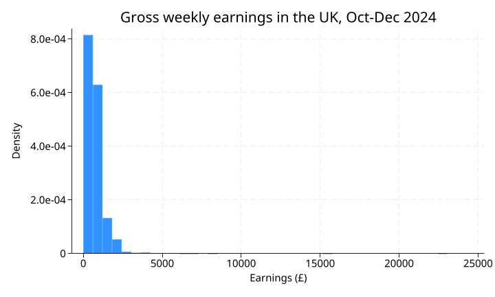
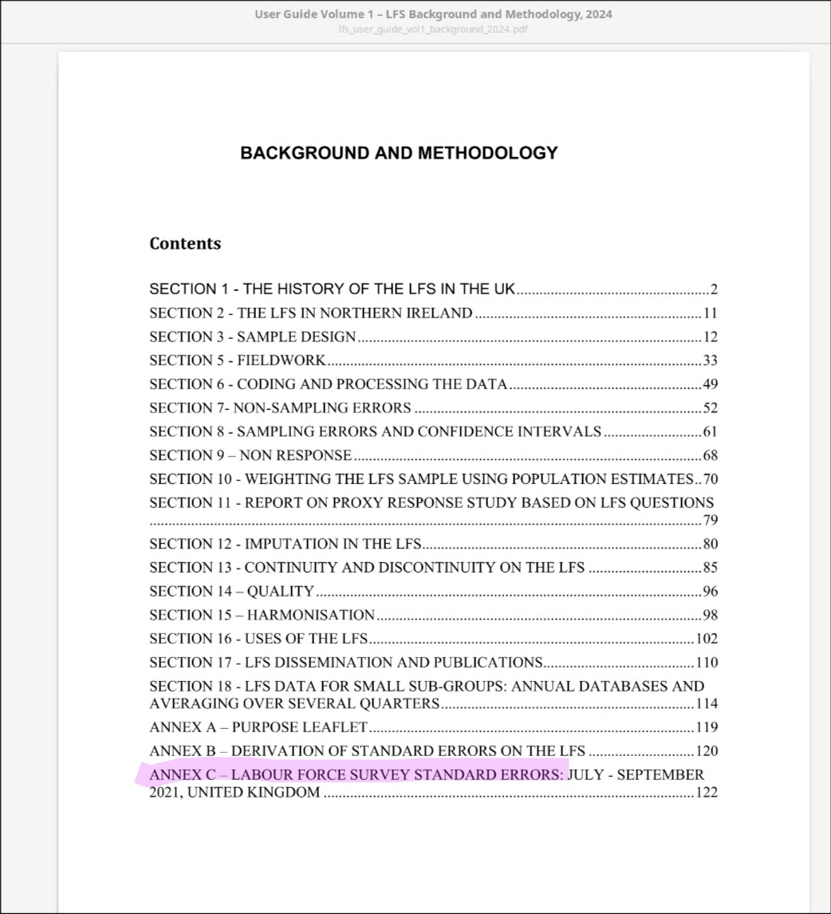
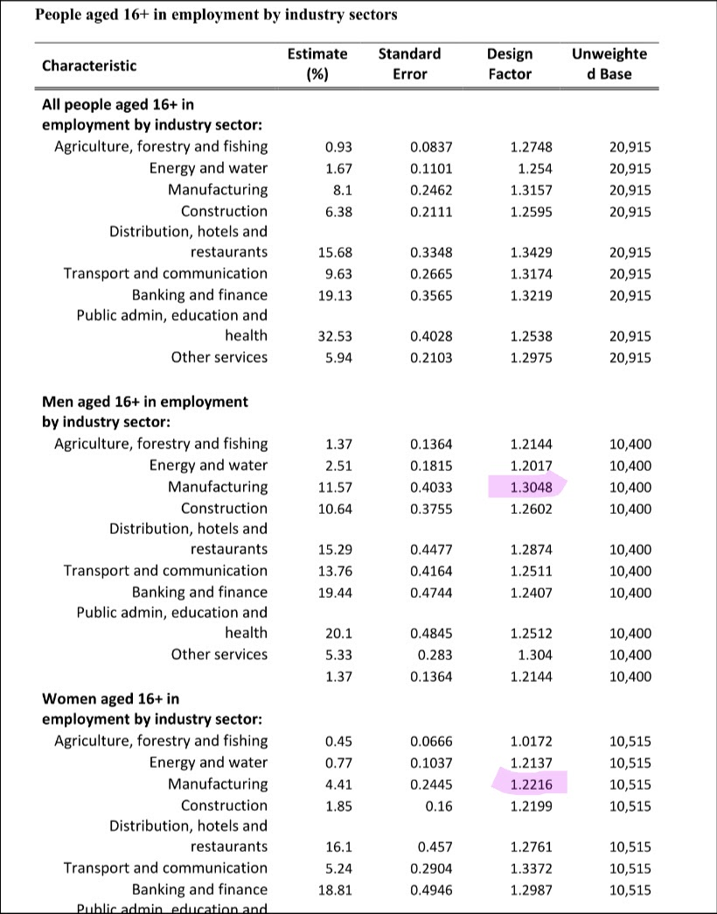
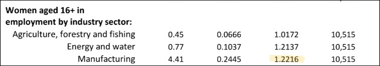
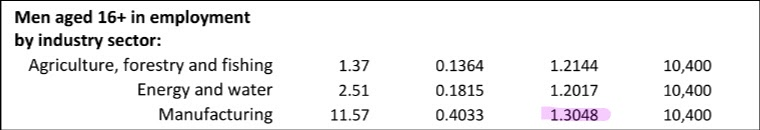

# Exercise 4: <BR/> Estimate precision and uncertainty


This series of exercises focuses on the precision of estimates calculated from  Labour Force Survey data, in other words  the degree to which we can trust  them to reflect  the likely values in  the population. In order to do this, we will compute similar measures as before - means and proportions but this time  we will be focusing on their confidence intervals.

Learning objectives:

- To be able to compute and interpret confidence intervals of earnings in the LFS;
- To be able to assess the impact of weighting on weighting ;
- To be able to interpret CIs for regional differences;
- To be able to use published LFS design effects  and apply them to your own estimates;

## Data

In this exercise we will be using Quarterly LFS data for October-December 2024.

To follow the exercise, you need to access the relevant dataset from the UK Data Service: [Quarterly Labour Force Survey, October - December, 2024](http://doi.org/10.5255/UKDA-SN-9349-3).

## Get set up

We will assume that the working directory for this exercise - where syntax files and other materials  will be located - will be a folder named `LFS_exercises`.   Once you have downloaded the data, save it somewhere accessible inside `LFS_exercises`, for example in  another folder named `Data`...  Then open the QLFS dataset:

```{stata open}
quietly cd  "LFS_exercises/"

* Import  the data from a Stata format dataset 
use  "Data/UKDA-9349-stata/stata/stata13/lfsp_od24_eul_pwt24.dta"
```

As previously, let's just keep the variables we need for the exercise. 


```{stata keep} 
keep PERSNO PIWT24 PWT24 GRSSWK INECAC05 ILODEFR FTPT HOURPAY SEX INDE07M GOVTOF2
  
```


## 1. Weighted and unweighted confidence intervals of mean weekly earnings
In this exercise, we will be  comparing the mean gross weekly earnings (`GRSSWK`) and  their confidence intervals using weighted and unweighted estimates. As previously, we will be using the  weighting variable specifically designed for earnings:  `PIWT24`.

First, let's examine gross weekly earnings and compute  its  unweighted mean:  

```{stata ex1}
*** Raw variable
summ GRSSWK

*** Removing non-responses
summ GRSSWK if GRSSWK>=0

quietly histogram   GRSSWK if GRSSWK>0, xtitle("Earnings (£)") title("Gross weekly earnings in the UK, Oct-Dec 2024")
```

```{stata plot}
*| echo: FALSE
quietly graph export "~/OneDrive/trainings/LFS_module/LFS_exercises/pics/grsw4.png", replace
```



We can  compute the mean this way:

```{stata mean}
mean GRSSWK if GRSSWK>=0
```
By default, Stata provides a 'naive' unweighted confidence interval of the mean. As a reminder, the 95% confidence interval of a mean is the value of the mean plus or minus 1.96 times its standard error. The standard error itself is the standard deviation divided by the square root of the sample size.


We could now say  - incorrectly -  that on the basis of unweighted sample values, we are 95% confident that the overall mean of gross weekly earnings in the UK population  range between £718 and £747 per week, that is an interval of  about £29.

Let's now compute the weighted mean and  confidence interval  of GRSSWK. There are different ways of doing this in Stata.  We will be using the same survey data specific functions as in previous exercises.


```{stata ci.w}
*** Let's declare our data to be survey data with PIWT as weight. 
svyset [pw=PIWT24]
 
*** ... Then get the weighted mean 
svy:mean GRSSWK

```

::: panel-tabset
### Questions
1. What are the bounds between which  we can be sure 95% of the values can be found, once we  weight the data?
2. How wide is the weighted confidence interval?
3. What is the effect of weighting the data on the precision of estimates?

### Answers
1. It is between £682 and £706  per week
2. £24
3. The confidence intervals  of weighted value tends to be wider than that of unweighted estimates, which makes them at the same time more representative but less precise than unweighted ones.

:::


## 2. Part-time  female employees across regions
In this second exercise, we will be looking at how to obtain and interpret confidence intervals of proportions by comparing the percentages of part-time employed  female employees  in London and the North West of England.
First, let's examine the variable for regions:

```{stata govtof}
 tab GOVTOF2,m
```

Let's recode the missing values in FTPT into system missing and flag the part-time employed.  

```{stata  regt}
recode FTPT 1 3=0 2 4=1 -9 -8=.,gen(FTPT2)

lab var FTPT2 "Whether is employed part-time"
lab def FTPT2 0 "Full-time" 1 "Part-time"

lab val FTPT2 FTPT2

tab  FTPT2,m
```


```{stata ldnnw}
*** We need to switch from PIWT24 to PWT24...
*** ... as we are not estimating earnings anymore

svyset [pw=PWT24]

svy:prop  FTPT2  if GOVTOF2==2 & SEX==2   & FTPT2!=., percent 
svy:prop  FTPT2  if GOVTOF2==8  & SEX==2  & FTPT2!=., percent 

*** Alternative methods
svy:tab GOVTOF2 FTPT2  if (GOVTOF2==2 | GOVTOF2==8)   & SEX==2 & FTPT2!=.,stubwidth(20) percent row ci
``` 

::: panel-tabset
### Questions
1. Are the width of the confidence intervals for London and The North West comparable?
2. Do the CI overlap? How do you interpret this?
3. Is it the same with the differences between the North East and the North West of England?

### Answers
1. Yes, they are very close at about 5 percentage points.
2. They don't overlap, meaning that the difference are likely to be significant (at the 95% threshold) in the population 
3. The confidence intervals clearly overlap. It is unlikely that significant difference in the proportion of female part-timers significantly differ between the two regions.

```{stata ne}
svy:tab GOVTOF2 FTPT2  if (GOVTOF2==1 | GOVTOF2==2)   & SEX==2 & FTPT2!=.,stubwidth(20) percent row ci
```
:::


## 3. Adjusting CIs with  published design effects

Design effects account for the impact of survey design (e.g., clustering and stratification) on the precision of estimates. Here, we will be adjusting the CI of the proportion of women and men employed (`ILODEFR`) in  manufacturing (`INDE07M`)  in their main job using design effects published in Volume 1 of the LFS documentation.

Let's begin by examining the sector variable and creating dummy variables. We recode "Does not apply" as system missing but keep the non responses (-8).

```{stata intab}
ta INDE07M if INDE07M!=-9,gen(IndSect) 
```
Given that we kept non-responses, manufacturing respondents are flagged with `IndSect4`
Let's then compute the proportion of men and women employed in manufacturing.

- Women:

```{stata citab.f}
svy:prop  IndSect4  if ILODEFR==1 & SEX==2, percent 
```

- ... And men:

```{stata citab.m}
svy:prop  IndSect4  if ILODEFR==1 & SEX==1, percent 

```


The above confidence intervals  do not take into account the survey design and depending on the variable, maybe too narrow ie overstate the precision of the estimates - or too wide. 

In order to compute more robust CIs or standard errors, we need to have access to survey design variables such as strata  and primary sampling units identifiers. These are unfortunately withheld by the producers of the LFS due to concerns about potential risk of disclosure of  personal information.

Another approach that can be implemented for some headline estimates consists in adapting  confidence intervals based on the design factors (DEFF) published by the ONS. These can be found in   the Volume 1 of the LFS documentation. For the October-December 2024 edition, this file is called: `lfs_user_guide_vol1_background_2024.pdf`.


::: {layout-nrow=2}
{fig-alt="Table of centent of Vol 1 of the LFS Documentation"}

{fig-alt="Overview of Annex 2 of the LFS Documentation, Volume 1."}
:::

The design effects for the proportion of females and males employed in manufacturing  are respectively 1.2216 and 1.3048:
 

::: {layout-nrow=2}
{fig-alt="Highlighted design factor for females"}

{fig-alt="Highlighted design effects for men"}

:::

We now need to adapt these to the confidence intervals we computed earlier. In order to do this, we need to start with the  standard errors - as the DEFF are meant to adjust these. We can then obtain the adjusted CIs for females.

From the above table, we can see that the proportion of women employed in manufacturing is 4.83, the standard error of this proportion, 0.19. From the documentation, we know that the design factor  is 1.2216. We are now able to compute the adjusted confidence intervals for females by hand:

```{stata adjfem}
*** Lower bound
dis 4.82-1.96*sqrt(0.19*1.2216)

*** Upper  bound
dis 4.82+1.96*sqrt(0.19*1.2216)
```

... For males: the proportion  employed in manufacturing is 11.01, the standard error 0.28 and the design factor  is 1.3048:

```{stata adjmal}
*** Lower bound
dis 10.98-1.96*sqrt(0.27*1.3048)

*** Upper  bound
dis 10.98+1.96*sqrt(0.27*1.3048)
```


::: panel-tabset
### Questions
1. What has happened to the confidence intervals after we adjusted them?
2. What if we wanted  to adjust our earlier estimates of gross weekly earnings for the design effects? 

### Answers
1.They have widened, which means that in this case, not taking the survey design led us to overestimate the precision of estimates.  
2. We would not be able to do this with the safeguarded version of the data as there are no  design factors for earnings published by the ONS. We would need to use the secured version of the data, and compute the adjusted estimates ourselves using the appropriate survey functions.
:::

