---
format:
  html: 
    code-fold: true
---

# Exercise 4: <BR/> Estimate precision and uncertainty

This series of exercises focuses on the precision of estimates calculated from  Labour Force Survey data, in other words  the degree to which we can trust  them to reflect  the likely values in  the population. In order to do this, we will compute similar measures as before - means and proportions - but this time  we will be focusing on their confidence intervals.

Learning objectives:

- To be able to compute and interpret confidence intervals of earnings in the LFS;
- To be able to assess the impact of weighting on confidence intervals (CI) ;
- To be able to interpret CIs for regional differences;
- To be able to use published LFS design effects  and apply them to your own estimates;

## Data

The data used in this exercise relates to an estimate published by the ONS for October-December 2024.

To follow the exercise, you need to access the relevant dataset from the UK Data Service: [Quarterly Labour Force Survey, October - December, 2024](http://doi.org/10.5255/UKDA-SN-9349-3).

## Get set up

We suggest that you create a folder named `LFS_exercises` as the working directory for this exercise -- where syntax files and other materials will be stored. After downloading the data, save it in an easily accessible location within `LFS_exercises`, such as a subfolder named `Data`.


Let's open the QLFS dataset from the *File* menu:

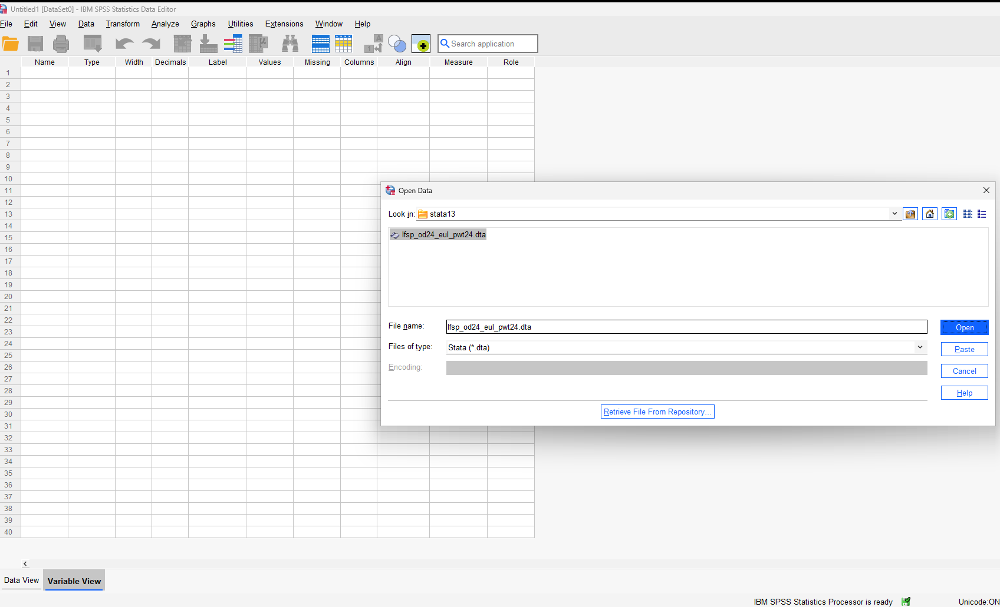{fig-alt="Screenshot of the SPSS File-Open menu"}


As previously, let's just keep the variables we need for the exercise. 


```{r, eval=FALSE} 
SAVE OUTFILE="Z://LFS_exercises/data/dataex4.sav" 
    /KEEP= PERSNO PIWT24 PWT24 GRSSWK  INECAC05  ILODEFR FTPT  HOURPAY SEX INDE07M GOVTOF2.

get FILE="Z://LFS_exercises/data/dataex4.sav". 
  
```

## Examine the working dataset

Let's inspect the data and the new variables by looking at the variables and data view:


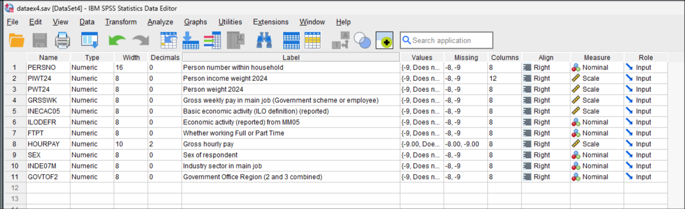{fig-alt="Exercise 4 dataset, variable view"}

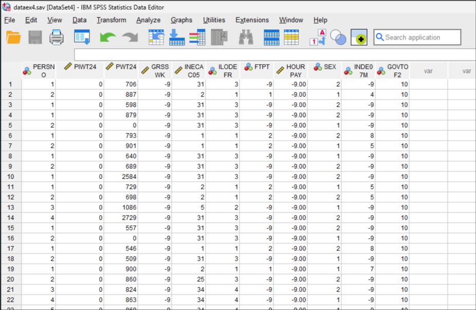{fig-alt="Exercise 4 dataset, data  view"}


## 1. Weighted and unweighted confidence intervals of mean weekly earnings
In this exercise, we are going to   compare the mean gross weekly earnings (`GRSSWK`) and  their confidence intervals using weighted and unweighted estimates. As previously, we will be using the  weighting variable specifically designed for earnings:  `PIWT24`.

First, let's examine gross weekly earnings and plot its distribution:  

```{ ex1}
EXAMINE VARIABLES = GRSSWK
    /STATISTICS = DESCRIPTIVES.
```

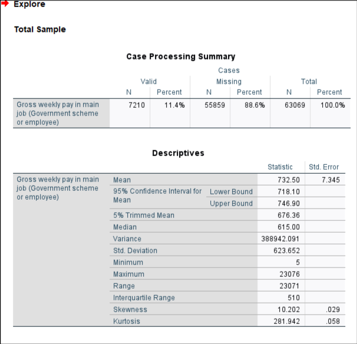{fig-alt="Descriptives statistics of Gross weekly earnings, including the confidence interval of the mean"}

By default, SPSS provides a 'naive' unweighted confidence interval of the mean. As a reminder, the 95% confidence interval of a mean is the value of the mean plus or minus 1.96 times its standard error. The standard error itself is the standard deviation divided by the square root of the sample size.


We could now say  - incorrectly -  that on the basis of unweighted sample values, we are 95% confident that the overall mean of gross weekly earnings in the UK population  range between £718 and £747 per week, that is an interval of  about £29.

Let's now compute the weighted mean and  confidence interval  of GRSSWK using the adequate, survey specific commands.  We first need to tell SPSS that we are working with survey data.

```{r eval=FALSE}

*** Let's declare our data to be survey data with PIWT as weight. 
*** We need to create a dummy strata identifier in order for the command to run

COMPUTE STRAT=0.
EXECUTE.

CSPLAN ANALYSIS
    /PLAN FILE= "Z://LFS_exercises/ex4.csaplan"
    /PLANVARS ANALYSISWEIGHT=PIWT24
    /DESIGN STRATA=STRAT 
    /ESTIMATOR TYPE=WR.
``` 

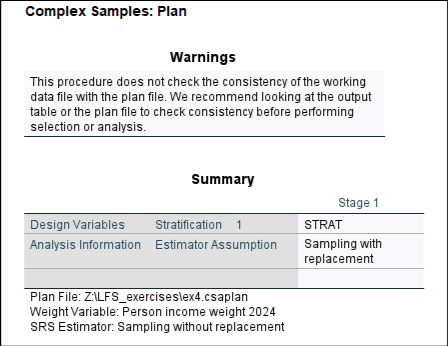{fig-alt="Output of SPSS CSPLAN (survey design set up) command"}
 
... Then we can compute  the weighted mean:


```
CSDESCRIPTIVES
  /PLAN FILE='Z:\LFS_exercises\ex4.csaplan'
  /SUMMARY VARIABLES=GRSSWK
  /MEAN
  /STATISTICS POPSIZE CIN(95)
  /MISSING SCOPE=ANALYSIS CLASSMISSING=EXCLUDE.
```
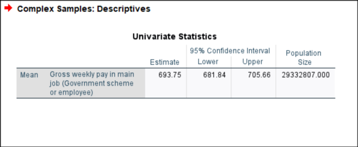{fig-alt="Survey design informed mean and confidence interval for GRSSWK"}


::: panel-tabset
### Questions
1. What are the bounds between which  we can be sure 95% of the values can be found, once we  weight the data?
2. How wide is the weighted confidence interval?
3. What is the effect of weighting the data on the precision of estimates?

### Answers
1. It is between £682 and £706  per week
2. £24
3. In general,  confidence intervals  and standard deviations of weighted estimates  tend to be wider than those of unweighted estimates, which makes them at the same time more representative but less precise. However, the opposite is true here: the weighted confidence intervals of GRSSWK are narrower than the unweighted ones. 


:::


## 2. Part-time  female employees across regions
In this second exercise, we will be looking at how to obtain and interpret confidence intervals of proportions by comparing the percentages of part-time   female employees  in London  and the North West of England.
First, let's examine the variable for regions:

```{ govtof}
FREQUENCIES VARIABLES=GOVTOF2.
```
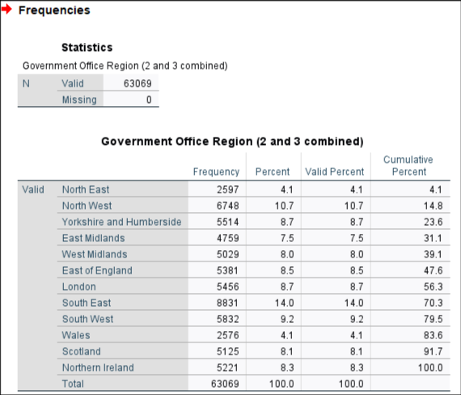{fig-alt="Frequency distribution GOVTOF2"}

Let's recode the missing values in FTPT into system missing and flag the part-time employed.  

```{  regt}
RECODE FTPT (1 3=0) (2 4=1) (-8 -9=SYSMIS) INTO FTPT2.
EXECUTE.

VARIABLE LABELS FTPT2 "Whether main job is full time".
VALUE LABELS FTPT2
    0 "Full-time"
    1 "Part-time".

FREQUENCIES VARIABLES=FTPT2.
```
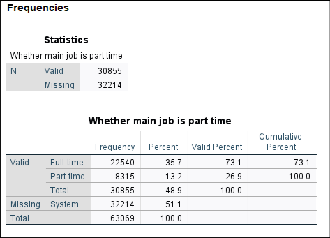{fig-alt="Frequency distribution of FTPT2"}

We are also going to create a simplified variable for region, flagging London and the Northwest: 

```{}
RECODE GOVTOF2 (2=1) (8=2) (1 3 THRU 7 9 THRU 12 =3) INTO NWL.
EXECUTE.

VARIABLE LABELS NWL "Whether in the NW or the London".
VALUE LABELS NWL
    1 "North West"
    2 "South East"
    3 "Other".

FREQUENCIES VARIABLES=NWL.
```
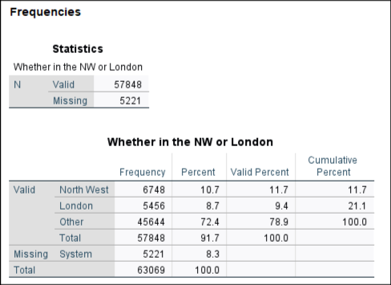{fig-alt="Frequency distribution of the London/Northwest rest of the UK flag"}

... And we can finally compute the population estimates for female part-timers in each area. Do not forget to redefine the survey design  using the person weight (`PWT24`) instead of the income weight (`PIWT24`)! 


```{ ldnnw}
* Redefining the survey design 
CSPLAN ANALYSIS
    /PLAN FILE= "Z://LFS_exercises/ex42.csaplan"
    /PLANVARS ANALYSISWEIGHT=PWT24
    /DESIGN STRATA=STRAT 
    /ESTIMATOR TYPE=WR.

* Computing the proportion of part-timer by each combination of region and gender
CSTABULATE
  /PLAN FILE='Z:\LFS_exercises\ex42.csaplan'
  /TABLES VARIABLES=FTPT2
  /SUBPOP TABLE=NWL BY SEX DISPLAY=LAYERED
  /CELLS TABLEPCT
  /STATISTICS  CIN(95)
  /MISSING SCOPE=TABLE CLASSMISSING=EXCLUDE.
``` 

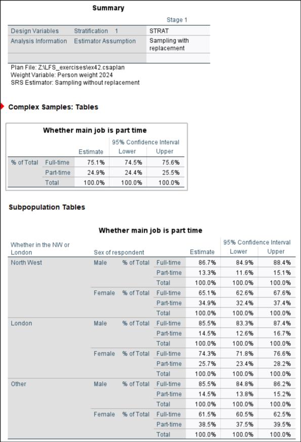{fig-alt="Proportion of female part-timers in the London and the Northwest - population estimates"}


::: panel-tabset
### Questions
1. Are the width of the confidence intervals for London and The North West comparable?
2. Do the CI overlap? How do you interpret this?
3. Is it the same with the differences between the North East and the North West of England?

### Answers
1. Yes, they are very close at about 5 percentage points.
2. They don't overlap, meaning that the difference are likely to be significant (at the 95% confidence level) in the population 
3. The confidence intervals clearly overlap. It is unlikely that significant difference in the proportion of female part-timers significantly differ between the two regions.

```{ ne}
CSTABULATE
  /PLAN FILE='Z:\LFS_exercises\ex42.csaplan'
  /TABLES VARIABLES=FTPT2
  /SUBPOP TABLE=GOVTOF2 BY SEX DISPLAY=LAYERED
  /CELLS TABLEPCT
  /STATISTICS  CIN(95)
  /MISSING SCOPE=TABLE CLASSMISSING=EXCLUDE.


```
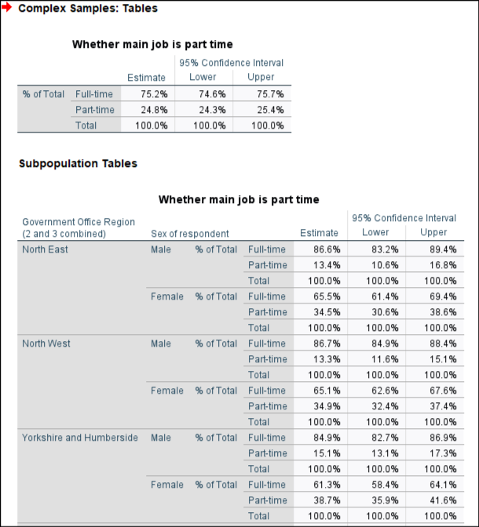{fig-alt="Proportion of female part-timers in the London and the Northwest - population estimates"}


:::


## 3. Adjusting CIs with  published design effects

Design effects account for the impact of survey design (e.g., clustering and stratification) on the precision of estimates. Here, we will be adjusting the CI of the proportion of women and men employed (`ILODEFR`) in  manufacturing (`INDE07M`)  in their main job using design effects published in Volume 1 of the LFS documentation.

Let's begin by examining the sector variable and creating a dummy variable for manufacturing sector. We recode "Does not apply" as system missing.

```{ govtof}
FREQUENCIES VARIABLES=INDE07M.
```

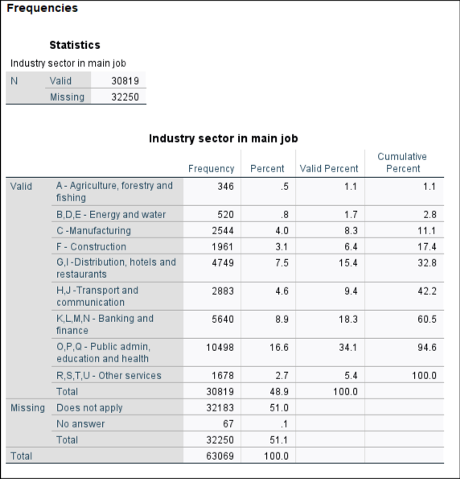{fig-alt="Frequency distribution of industry in the LFS sample"}


```{}
RECODE INDE07M (-8 1 2 4 THRU 9 =0) (3=1) (-9=SYSMIS) INTO Ind_Man.
EXECUTE.

VARIABLE LABELS Ind_Man "Whether works in the manufacturing industries".

* ... And the value labels

VALUE LABELS Ind_Man
    0 "Any other industry"
    1 "Manufacturing".

FREQUENCIES VARIABLES=Ind_Man.
```

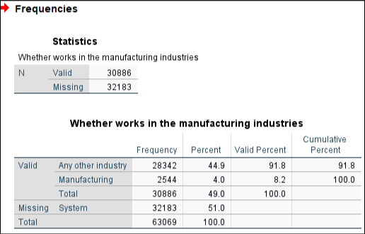{fig-alt="Frequency distribution of whether works in manufacturing industries"}


Let's now compute the proportion of men and women employed in manufacturing.

```{}
CSTABULATE
  /PLAN FILE='Z:\LFS_exercises\ex42.csaplan'
  /TABLES VARIABLES=Ind_Man
  /SUBPOP TABLE=ILODEFR BY SEX DISPLAY=LAYERED
  /CELLS TABLEPCT
  /STATISTICS  CIN(95) SE
  /MISSING SCOPE=TABLE CLASSMISSING=EXCLUDE.
```


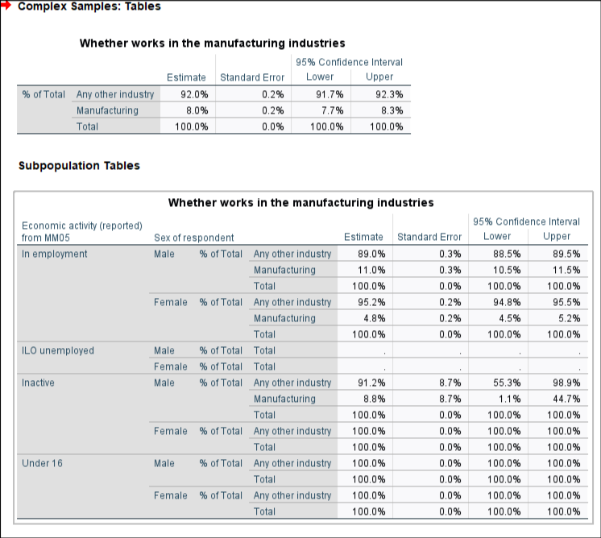{fig-alt="Population estimates of men and women employed in the manufacturing industries "}

The above confidence intervals  do not take into account the survey design and depending on the variable, maybe too narrow ie overstate the precision of the estimates - or too wide. 

In order to compute more robust CIs or standard errors, we need to have access to survey design variables such as strata  and primary sampling units identifiers. These are unfortunately withheld by the producers of the LFS due to concerns about potential risk of disclosure of  personal information.

Another approach that can be implemented for some headline estimates consists in adapting  confidence intervals based on the design factors (DEFF) published by the ONS. These can be found in   the Volume 1 of the LFS documentation. For the October-December 2024 edition, this file is called: `lfs_user_guide_vol1_background_2024.pdf`.


::: {layout-nrow=2}
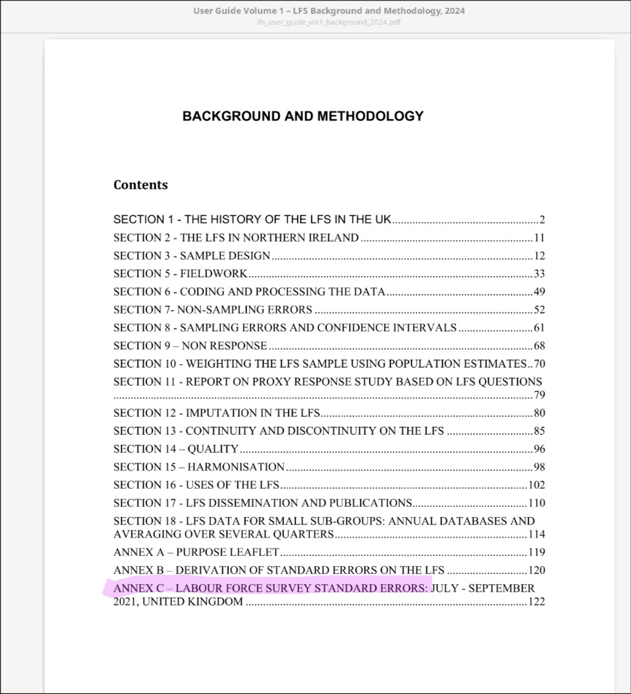{fig-alt="Table of centent of Vol 1 of the LFS Documentation"}

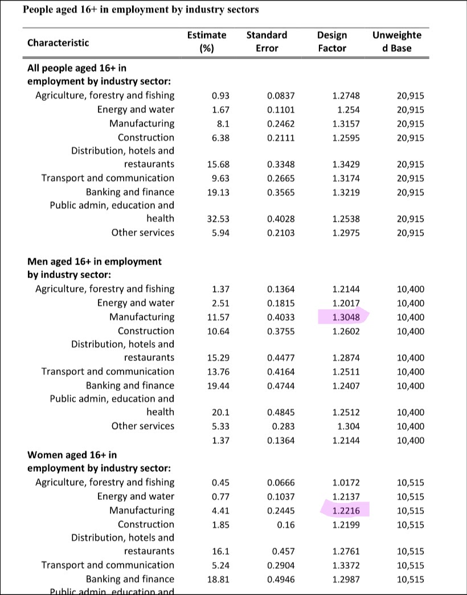{fig-alt="Overview of Annex 2 of the LFS Documentation, Volume 1."}
:::

The design effects for the proportion of females and males employed in manufacturing  are respectively 1.2216 and 1.3048:
 

::: {layout-nrow=2}
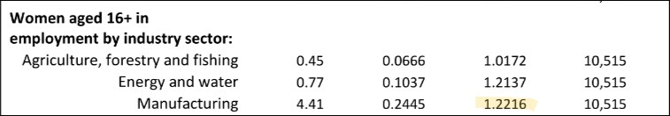{fig-alt="Highlighted design factor for females"}

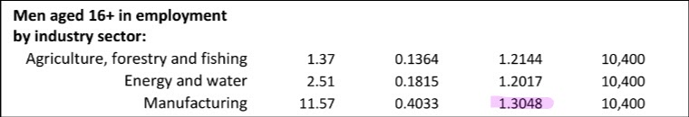{fig-alt="Highlighted design effects for men"}

:::

We now need to adapt these to the confidence intervals we computed earlier. In order to do this, we need to start with the  standard errors - as the DEFF are meant to adjust these. We can then obtain the adjusted CIs for females.  

From the above table, we can see that the proportion of women employed in manufacturing is 4.83, the standard error of this proportion, 0.19. From the documentation, we know that the design factor  is 1.2216. We are now able to compute the adjusted confidence intervals for females by hand:

```{ adjfem}
*** Lower bound
 4.82-1.96*sqrt(0.19*1.2216) :  3.9

*** Upper  bound
 4.82+1.96*sqrt(0.19*1.2216) : 5.8
```

... For males: the proportion  employed in manufacturing is 11.01, the standard error 0.28 and the design factor  is 1.3048:

```{ adjmal}
*** Lower bound
 10.98-1.96*sqrt(0.27*1.3048) :  9.8

*** Upper  bound
 10.98+1.96*sqrt(0.27*1.3048) : 12.1
```


::: panel-tabset
### Questions
1. What has happened to the confidence intervals after we adjusted them?
2. What if we wanted  to adjust our earlier estimates of gross weekly earnings for the design effects? 

### Answers
1. They have widened: from [4.5-5.2] to [3.9-5.8]  for women and  from [10.5-11.5] to [9.8-12.1] for men, which means that in this case, not taking the survey design led us to overestimate the precision of estimates.  
2. We would not be able to do this with the safeguarded version of the data as there are no  design factors for earnings published by the ONS. We would need to use the secured version of the data, and compute the adjusted estimates ourselves using the appropriate survey functions.
:::

